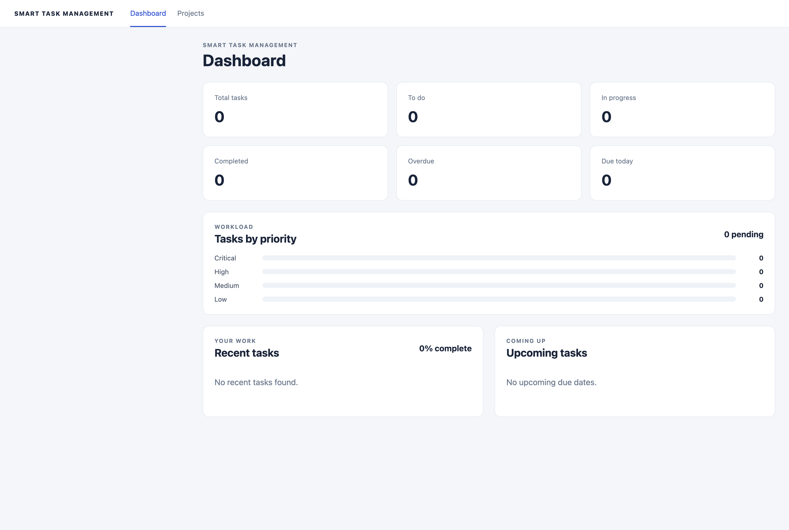

# Smart Task Management System

[](https://github.com/Mohammadkhan01/SmartTaskManagement/actions/workflows/ci.yml)

## Project Overview

Smart Task Management is a full-stack project and task tracker. Teams group
work into projects, move tasks through their lifecycle, collaborate with
comments and attachments, and follow progress on a dashboard. An AI assistant
rewrites rough task descriptions into clear, actionable ones, and the user
reviews the suggestion before anything is saved.

- **Backend**: ASP.NET Core Web API (.NET 10) in an N-Layer architecture
  (`API → BLL → DAL → Domain`, plus `Common`), EF Core with SQL Server.
- **Frontend**: Angular 21 single-page app with standalone components.
- **Roles**: `Admin`, `Project Manager`, `Team Member`.

Further reading:

| Document | Contents |
| --- | --- |
| [`PROMPTS.md`](PROMPTS.md) | AI prompt design, structure, examples, validation and safety |
| [`docs/architecture.md`](docs/architecture.md) | Layer, request-flow, authentication and AI provider diagrams |
| [`docs/database/README.md`](docs/database/README.md) | ERD, table reference, migrations |
| [`docs/TRACEABILITY.md`](docs/TRACEABILITY.md) | Requirement → implementation → test mapping |
| [`docs/performance.md`](docs/performance.md) | Latency smoke test results |
| [`docs/screenshots`](docs/screenshots) | UI screenshots |

## Technology Stack

| Area | Technology |
| --- | --- |
| API | ASP.NET Core Web API (.NET 10), controllers, `Microsoft.AspNetCore.OpenApi` + Swagger UI |
| Security | ASP.NET Core Identity (password hashing, lockout), JWT bearer access tokens, rotating refresh tokens (HttpOnly cookie), antiforgery (CSRF), CORS, rate limiting, HTTPS/HSTS |
| Business logic | Services behind interfaces, FluentValidation, async/await throughout |
| Data access | Entity Framework Core (code-first migrations), repositories + Unit of Work, SQL Server 2022 |
| Cross-cutting | Serilog structured request logging, global exception handler (RFC 7807 problem details), health checks |
| AI | Pluggable `IAiTextProvider`: offline `Mock`, any OpenAI-compatible API (`OpenAI`), or the free **GitHub Models** service (`GitHubModels`) |
| Frontend | Angular 21 standalone components, signals, reactive forms, lazy-loaded routes, route guards, HTTP interceptor, RxJS |
| Tests | xUnit (unit, integration against SQL Server, architecture), Vitest (Angular) |
| Tooling | Docker Compose (SQL Server), GitHub Actions CI |

## Setup Instructions

All commands run from the repository root unless noted.

### Prerequisites

- .NET 10 SDK
- Node.js LTS and npm
- Docker Desktop
- EF Core CLI: `dotnet tool install --global dotnet-ef`

### 1. Start SQL Server

```bash
cp docker/.env.example docker/.env
# Edit docker/.env and set MSSQL_SA_PASSWORD to a strong local password.
docker compose --env-file docker/.env -f docker/docker-compose.yml up -d
docker compose --env-file docker/.env -f docker/docker-compose.yml ps   # wait for "healthy"
```

This starts `mcr.microsoft.com/mssql/server:2022-latest` as the container
`azuresqledge` on port 1433, with data in the named volume
`smarttask-sqldata`. If you already have an `azuresqledge` container, you can
keep using it; `docker compose ... down` stops it without deleting data
(`down -v` deletes the volume). `docker/.env` is read by Docker only, not by
the API.

### 2. Configure API secrets (User Secrets)

The API project has a `UserSecretsId`. Set the required keys (replace the
placeholders; never commit real values):

```bash
API=src/SmartTask.API/SmartTask.API.csproj
dotnet user-secrets set "ConnectionStrings:DefaultConnection" "Server=localhost,1433;Database=SmartTaskDb;User Id=sa;Password=<password>;TrustServerCertificate=True" --project $API
dotnet user-secrets set "Jwt:Issuer" "SmartTask.API" --project $API
dotnet user-secrets set "Jwt:Audience" "SmartTask.Frontend" --project $API
dotnet user-secrets set "Jwt:SigningKey" "<random key, at least 32 UTF-8 bytes>" --project $API
```

The API refuses to start if the connection string or JWT settings are missing
or invalid. In production supply the same keys as environment variables
(`ConnectionStrings__DefaultConnection`, `Jwt__SigningKey`, `Ai__ApiKey`, …)
from a secret manager.

### 3. Apply EF Core migrations

Design-time EF commands read the connection string from an environment
variable (not from User Secrets):

```bash
export SMARTTASK_DESIGN_TIME_CONNECTION_STRING="Server=localhost,1433;Database=SmartTaskDb;User Id=sa;Password=<password>;TrustServerCertificate=True"
dotnet ef database update --project src/SmartTask.DAL --startup-project src/SmartTask.API
unset SMARTTASK_DESIGN_TIME_CONNECTION_STRING
```

Migrations are in `src/SmartTask.DAL/Persistence/Migrations`. Roles are
seeded automatically at startup.

### 4. HTTPS development certificate

Both the API and the Angular dev server use HTTPS. Trust the .NET dev
certificate and export it as PEM for Angular (`frontend/angular.json` reads
`.certs/localhost.pem` and `.certs/localhost.key`; the folder is git-ignored):

```bash
dotnet dev-certs https --trust
mkdir -p frontend/.certs
dotnet dev-certs https --export-path frontend/.certs/localhost.pem --format Pem --no-password
```

### 5. Run the API

```bash
dotnet run --launch-profile https --project src/SmartTask.API
```

The API listens on `https://localhost:7251` (and `http://localhost:5018`,
which redirects to HTTPS). In Development, Swagger UI is at
`https://localhost:7251/swagger`, and the health check is at
`https://localhost:7251/health`.

### 6. Run the frontend

```bash
cd frontend
npm ci
npm start
```

Open exactly **https://localhost:4200**. CORS allows only the origins in
`Cors:AllowedOrigins` (`https://localhost:4200` in Development), so other
URLs printed by the dev server (network IP, `127.0.0.1`) fail CORS.

### 7. Configure the AI provider

`Ai:Provider` selects the provider:

| `Ai:Provider` | Use | Credentials |
| --- | --- | --- |
| `Mock` | **Default in Development** (`appsettings.Development.json`). Deterministic, offline, no key needed. | None |
| `GitHubModels` | Free hosted models via [GitHub Models](https://github.com/marketplace/models). Calls `https://models.github.ai/inference/chat/completions`. | GitHub personal access token with the `models:read` permission |
| `OpenAI` | Default in `appsettings.json`. Any OpenAI-compatible Chat Completions API at `{Ai:BaseUrl}/chat/completions`. | Provider API key |

To use GitHub Models (free) locally:

```bash
API=src/SmartTask.API/SmartTask.API.csproj
dotnet user-secrets set "Ai:Provider" "GitHubModels" --project $API
dotnet user-secrets set "Ai:Model" "openai/gpt-4o-mini" --project $API   # optional; "gpt-4o-mini" is prefixed with "openai/" automatically
dotnet user-secrets set "Ai:ApiKey" "<GitHub PAT with models:read>" --project $API
```

Other `Ai` settings (defaults in `appsettings.json`): `TimeoutSeconds` (20),
`MaxOutputTokens` (1500), `Temperature` (0.2), `UseJsonResponseFormat`
(true). If the key is missing the endpoint returns 503 rather than failing
startup. See [`PROMPTS.md`](PROMPTS.md) for the prompt itself.

### 8. Development admin account (optional)

New registrations get the `Team Member` role. To seed an `Admin` at startup
(Development only), set:

```bash
dotnet user-secrets set "DevelopmentAdmin:Enabled" "true" --project $API
dotnet user-secrets set "DevelopmentAdmin:Email" "<admin email>" --project $API
dotnet user-secrets set "DevelopmentAdmin:Password" "<password meeting the policy>" --project $API
```

The admin can then promote users to `Project Manager` on the **Users** page.
Passwords need at least 12 characters with upper-case, lower-case, digit and
symbol; 5 failed sign-ins lock the account for 15 minutes.

### 9. Run the tests

```bash
# Backend unit and architecture tests
dotnet build SmartTaskManagement.sln -nodeReuse:false
dotnet test tests/SmartTask.UnitTests -nodeReuse:false
dotnet test tests/SmartTask.ArchitectureTests -nodeReuse:false

# Integration tests against a dedicated SmartTaskTestDb database.
# Uses SMARTTASK_TEST_CONNECTION_STRING if set, otherwise MSSQL_SA_PASSWORD from docker/.env;
# applies migrations to SmartTaskTestDb first. Extra args go to dotnet test.
scripts/run-integration-tests.sh

# Frontend unit tests and production build
cd frontend
npx ng test --watch=false
npx ng build
```

Never point integration tests at development or production data. CI
([`.github/workflows/ci.yml`](.github/workflows/ci.yml)) runs all of the
above on every push to `main` and on pull requests, using an ephemeral SQL
Server service container.

## API Overview

Base URL: `https://localhost:7251`. All routes are versioned under
`/api/v1`. Unless marked *anonymous*, every endpoint needs
`Authorization: Bearer <accessToken>`. State-changing auth endpoints also need
the `X-CSRF-TOKEN` header from `GET /api/v1/auth/csrf`.

**Response conventions.** Successful calls return the resource DTO (JSON);
list endpoints return a paged envelope
`{ items, pageNumber, pageSize, totalCount, totalPages }`. Every error is an
RFC 7807 `application/problem+json` body with a `traceId` (validation errors
add an `errors` dictionary). Common statuses: 400 validation, 401, 403, 404,
409 concurrency/conflict, 429 rate limit.

**Interactive docs.** Swagger UI at `https://localhost:7251/swagger`
(Development only; click **Authorize** and paste an access token). Offline:
[`docs/api/openapi.json`](docs/api/openapi.json), and a Postman collection +
environment in [`docs/api`](docs/api) whose scripts store the CSRF token,
access token and created ids. Sample requests are also in
[`src/SmartTask.API/SmartTask.API.http`](src/SmartTask.API/SmartTask.API.http).

### Authentication

| Method | Route | Access |
| --- | --- | --- |
| GET | `/api/v1/auth/csrf` | Anonymous. Returns the antiforgery token |
| POST | `/api/v1/auth/register` | Anonymous, CSRF, auth rate limit. New users get `Team Member` |
| POST | `/api/v1/auth/login` | Anonymous, CSRF, auth rate limit. Returns access token; sets refresh cookie |
| POST | `/api/v1/auth/refresh` | Anonymous (refresh cookie), CSRF, auth rate limit. Rotates the refresh token |
| POST | `/api/v1/auth/logout` | Anonymous, CSRF. Revokes the refresh token and clears the cookie |
| GET | `/api/v1/auth/me` | Authenticated |

### Projects and members

| Method | Route | Access |
| --- | --- | --- |
| GET | `/api/v1/projects` | Authenticated. Admin sees all projects; others see projects they belong to. Query: `search`, `status`, `sortBy` (`createdAt`, `updatedAt`, `name`, `status`), `sortDescending`, `pageNumber`, `pageSize` (≤ 100) |
| POST | `/api/v1/projects` | Admin or Project Manager (creator becomes project manager) |
| GET | `/api/v1/projects/{id}` | Admin or project member |
| PUT | `/api/v1/projects/{id}` | Admin, or Project Manager who manages the project (optimistic concurrency via `rowVersion`) |
| DELETE | `/api/v1/projects/{id}` | Admin, or Project Manager who manages the project (soft delete) |
| GET | `/api/v1/projects/{id}/members` | Admin or project member |
| POST | `/api/v1/projects/{id}/members` | Admin, or Project Manager who manages the project |
| DELETE | `/api/v1/projects/{id}/members/{userId}` | Admin, or Project Manager who manages the project |

### Tasks

| Method | Route | Access |
| --- | --- | --- |
| GET | `/api/v1/projects/{projectId}/tasks` | Admin or project member. Query: `search`, `status`, `priority`, `assignedToUserId`, `dueDateFromUtc`, `dueDateToUtc`, `sortBy` (`createdAt`, `updatedAt`, `dueDate`, `title`, `priority`, `status`), `sortDescending`, `pageNumber`, `pageSize` (≤ 100) |
| POST | `/api/v1/projects/{projectId}/tasks` | Admin, or Project Manager who manages the project |
| GET | `/api/v1/tasks/{taskId}` | Admin or project member |
| PUT | `/api/v1/tasks/{taskId}` | Admin, or Project Manager who manages the project |
| PUT | `/api/v1/tasks/{taskId}/assign` | Admin, or Project Manager who manages the project (project must be Active) |
| PUT | `/api/v1/tasks/{taskId}/status` | Admin, managing Project Manager, or the Team Member assigned to the task |
| DELETE | `/api/v1/tasks/{taskId}` | Admin, or Project Manager who manages the project |

Status values: `1` To Do, `2` In Progress, `3` Completed, `4` Cancelled.
Priority values: `1` Low, `2` Medium, `3` High, `4` Critical.

### Collaboration

| Method | Route | Access |
| --- | --- | --- |
| GET, POST | `/api/v1/tasks/{taskId}/comments` | Project members |
| PUT | `/api/v1/task-comments/{commentId}` | Comment author |
| DELETE | `/api/v1/task-comments/{commentId}` | Comment author or project manager |
| GET, POST | `/api/v1/tasks/{taskId}/attachments` | Project members (upload is multipart) |
| GET | `/api/v1/task-attachments/{attachmentId}` | Project members |
| GET | `/api/v1/task-attachments/{attachmentId}/download` | Project members |
| DELETE | `/api/v1/task-attachments/{attachmentId}` | Uploader or project manager |
| GET | `/api/v1/tasks/{taskId}/activity` | Project members |
| GET | `/api/v1/notifications` | Authenticated (own notifications) |
| PATCH | `/api/v1/notifications/{notificationId}/read` | Authenticated (own notification) |
| PATCH | `/api/v1/notifications/read-all` | Authenticated |

### Dashboard

| Method | Route | Access |
| --- | --- | --- |
| GET | `/api/v1/dashboard/summary` | Authenticated. Task counts by status, overdue, due today, completion %, recent tasks, `projectTotals` (total projects and by status) |
| GET | `/api/v1/dashboard/task-statistics` | Authenticated. Counts by status and priority, pending, completion %, tasks due in the next 7 days |
| GET | `/api/v1/dashboard/projects/{projectId}` | Project member |
| GET | `/api/v1/dashboard/projects/{projectId}/workload` | Project manager of that project |
| GET | `/api/v1/admin/dashboard` | `Admin` role. System-wide project, task and user totals |

### Administration

| Method | Route | Access |
| --- | --- | --- |
| GET | `/api/v1/admin/users` | `Admin` role. Query: `search`, `isActive`, `role`, sort, paging |
| PATCH | `/api/v1/admin/users/{id}/status` | `Admin` role. Activate/deactivate (cannot remove the last active admin) |
| PUT | `/api/v1/admin/users/{id}/role` | `Admin` role. Change role |

### AI and health

| Method | Route | Access |
| --- | --- | --- |
| POST | `/api/v1/ai/enhance-task-description` | Authenticated, AI rate limit (10/min per user). Body `{ "title"?: string ≤ 200, "description": string ≤ 4000 }` → `{ "enhancedDescription": string }`. Errors 400/401/429/502/503/504. Nothing is saved |
| GET | `/health` | Anonymous. Self and database checks |

## Folder Structure

```text
.
├── README.md                     This file
├── PROMPTS.md                    AI prompt documentation
├── SmartTaskManagement.sln       .NET solution (5 src + 3 test projects)
├── .github/workflows/ci.yml      CI: backend build + all .NET tests + publish; frontend tests + build
├── docker/
│   ├── docker-compose.yml        Local SQL Server 2022 (container "azuresqledge")
│   └── .env.example              Template for MSSQL_SA_PASSWORD (copy to git-ignored .env)
├── scripts/
│   ├── run-integration-tests.sh  Migrates SmartTaskTestDb, then runs integration tests
│   ├── perf-smoke.sh             Latency smoke test against a running API
│   ├── run-api.sh                Runs the API with variables exported from docker/.env (no launch profile)
│   └── bootstrap-backend.sh      Historical scaffolding script that created the solution (do not re-run)
├── docs/
│   ├── architecture.md           Architecture and flow diagrams (Mermaid)
│   ├── database/README.md        ERD, tables, migrations
│   ├── api/                      openapi.json, Postman collection + environment
│   ├── TRACEABILITY.md           Requirement → code → test traceability
│   ├── performance.md            Performance smoke results
│   ├── SMART_TASK_MANAGEMENT_ENGINEERING_HANDBOOK.md  Detailed requirements and standards
│   └── screenshots/              UI screenshots (01–08)
├── src/
│   ├── SmartTask.API/            Web host: controllers, JWT/antiforgery setup, rate limiting, CORS,
│   │                             GlobalExceptionHandler, health checks, Serilog, OpenAPI, dev admin seeder
│   ├── SmartTask.BLL/            Business services, DTOs, FluentValidation validators, service and
│   │                             repository interfaces, AI prompt (Services/AI/TaskDescriptionPrompt.cs)
│   ├── SmartTask.DAL/            EF Core DbContext, configurations, migrations, repositories, Unit of Work,
│   │                             Identity, local file storage, AI providers (Ai/)
│   ├── SmartTask.Domain/         Entities and enums (no dependencies)
│   └── SmartTask.Common/         RoleNames, FieldLimits, shared exceptions, PagedResponse, Pagination
├── tests/
│   ├── SmartTask.UnitTests/          Services, validators, repositories, JWT, AI providers
│   ├── SmartTask.IntegrationTests/   HTTP pipeline + SQL Server (auth, CORS, rate limits, tasks, AI, …)
│   └── SmartTask.ArchitectureTests/  Layer-boundary rules
└── frontend/                     Angular 21 app
    ├── angular.json              Build/serve config (HTTPS dev server using .certs/)
    ├── package.json              Scripts: start, build, test
    └── src/app/
        ├── app.routes.ts         Lazy-loaded routes with authGuard / adminGuard
        ├── core/                 API services, SessionStore, auth interceptor, guards, models
        ├── features/             auth (login/register), dashboard, projects, tasks, admin
        ├── layouts/              App shell (navigation, logout)
        └── shared/               Pipes
```

## Features

- **Auth**: register, login, logout, JWT access tokens (15 min), rotating
  refresh tokens in an HttpOnly cookie, CSRF protection, lockout, deactivated
  users rejected even with a valid token.
- **Projects**: create, edit (with concurrency check), soft delete, details,
  members; list with search, status filter, sort and pagination.
- **Tasks**: create, edit, assign, change status, priority, due date, delete;
  list with search, status/priority filters, sort and pagination.
- **Dashboard**: total projects, total tasks, tasks by status, tasks by
  priority, completed vs pending, overdue/due today, recent and upcoming tasks;
  admins also see a system-wide overview.
- **AI**: "Enhance with AI" on the task form returns a suggestion that the
  user must accept or discard.
- **Collaboration and audit**: comments, attachments, activity history,
  notifications, audit log of changes.

## Security

- Passwords hashed by ASP.NET Core Identity; strong password policy and
  lockout.
- Role- and membership-based authorization in the business layer; admin
  endpoints use `[Authorize(Roles = "Admin")]`.
- HTTPS redirection everywhere; HSTS outside Development.
- CORS allows credentials only for explicit origins (wildcards rejected at
  startup).
- Rate limiting: auth endpoints 10 requests/60 s per IP; AI endpoint 10
  requests/60 s per user (HTTP 429 when exceeded). Behind a reverse proxy,
  configure Forwarded Headers with trusted proxies only; otherwise all
  clients may share the proxy's IP partition.
- Secrets come only from User Secrets or environment variables; logs never
  contain secrets, prompts or AI output.

## Screenshots

| Screen | File |
| --- | --- |
| Registration with password rules | [`01-register-password-rules.png`](docs/screenshots/01-register-password-rules.png) |
| Dashboard | [`02-dashboard.png`](docs/screenshots/02-dashboard.png) |
| Admin user management | [`03-admin-users.png`](docs/screenshots/03-admin-users.png) |
| Edit project status | [`04-project-edit-status.png`](docs/screenshots/04-project-edit-status.png) |
| Task form with AI suggestion | [`05-task-form-ai-suggestion.png`](docs/screenshots/05-task-form-ai-suggestion.png) |
| Task details (assigned, in progress) | [`06-task-details-assigned-in-progress.png`](docs/screenshots/06-task-details-assigned-in-progress.png) |
| Task list | [`07-task-list.png`](docs/screenshots/07-task-list.png) |
| Dashboard after creating a task | [`08-dashboard-after-task.png`](docs/screenshots/08-dashboard-after-task.png) |



## Deliverables

| Deliverable | Location |
| --- | --- |
| Source code | This repository (`src/`, `frontend/`, `tests/`) |
| Database | EF Core migrations in `src/SmartTask.DAL/Persistence/Migrations` (to produce a SQL script, set `SMARTTASK_DESIGN_TIME_CONNECTION_STRING` as in step 3 and run `dotnet ef migrations script --idempotent --project src/SmartTask.DAL --startup-project src/SmartTask.API -o smarttask.sql`) |
| README | `README.md` |
| AI prompt documentation | [`PROMPTS.md`](PROMPTS.md) |
| API collection | [`docs/api`](docs/api): Postman collection + environment, OpenAPI export; live Swagger UI at `/swagger` |
