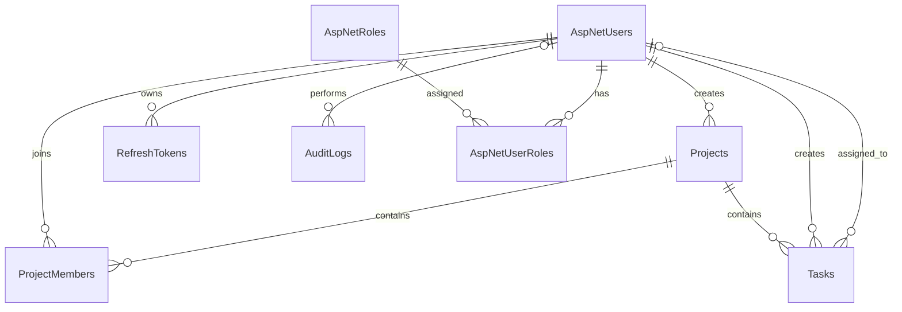

# SMART TASK MANAGEMENT SYSTEM
## Software Engineering Standards, Architecture & Database Design Handbook

**Document Version:** 3.0
**Document Type:** Software Engineering and Implementation Specification
**Backend:** ASP.NET Core 9/10, C#
**Architecture:** N-Layer
**ORM:** Entity Framework Core
**Database:** Microsoft SQL Server
**Frontend:** Angular 18+, TypeScript
**Authentication:** ASP.NET Core Identity + JWT

---

# DOCUMENT CONTROL

| Item | Details |
|---|---|
| Document title | Smart Task Management System — Engineering, Architecture & Database Design Handbook |
| Version | 3.0 |
| Status | Approved design baseline, pending final comparison with original assignment |
| Architecture | N-Layer backend / Three-tier deployment |
| Database | Microsoft SQL Server |
| ORM | Entity Framework Core |
| Backend | ASP.NET Core 9/10 |
| Frontend | Angular 18+ |
| API documentation | Swagger / OpenAPI |

## Revision History

| Version | Changes |
|---|---|
| 1.0 | Initial engineering specification |
| 1.1 | Book-style structure, contents and subject index |
| 2.0 | Requirements compliance, scope control and traceability |
| 3.0 | Detailed database design, ERD, schema, constraints, indexes and migration standards |

---

# TABLE OF CONTENTS

## PART I — PROJECT GOVERNANCE

1. Introduction and Project Objectives
2. Requirements Verification and Scope Control
3. Requirement Traceability and Acceptance Criteria
4. System Architecture and Design Principles

## PART II — DATABASE ENGINEERING

5. Database Design Overview
6. Entity Relationship Design
7. Detailed Database Schema
8. Database Constraints, Indexes and Data Integrity
9. EF Core Implementation and Migration Strategy

## PART III — BACKEND AND API ENGINEERING

10. Backend Engineering Standards
11. API Design Standards
12. Application Security

## PART IV — FRONTEND AND AI ENGINEERING

13. Angular Frontend Engineering
14. AI Integration

## PART V — QUALITY AND OPERATIONS

15. Testing Strategy
16. Logging and Observability
17. Performance Engineering
18. DevOps and Deployment

## PART VI — DELIVERY AND ACCEPTANCE

19. Documentation Standards
20. Engineering Quality and Final Acceptance
21. Development Execution Plan

## APPENDICES

- Appendix A — Repository Structure
- Appendix B — Database Relationship Reference
- Appendix C — Detailed Database Data Dictionary
- Appendix D — Role and Permission Reference
- Appendix E — API Endpoint Reference
- Appendix F — Technology Reference
- Appendix G — Performance Targets
- Appendix H — Requirement Traceability Matrix
- Appendix I — Explicitly Excluded Features
- Appendix J — Database Implementation Checklist
- Appendix K — Final Quality Checklist

---

# PART I — PROJECT GOVERNANCE

# CHAPTER 1 — INTRODUCTION AND PROJECT OBJECTIVES

## 1.1 Purpose

The Smart Task Management System is a web-based application for managing projects, tasks, assignments, users and task progress.

The system supports three global user roles:

- Admin
- Project Manager
- Team Member

Users will be able to manage projects, create and assign tasks, monitor progress and view dashboard statistics.

An AI-powered feature will help users improve task descriptions.

## 1.2 Primary Objectives

1. Provide secure user authentication.
2. Implement role-based and resource-level authorization.
3. Manage projects and project membership.
4. Manage tasks and assignments.
5. Support task status, priority and due dates.
6. Provide dashboard statistics.
7. Support search, sorting and pagination.
8. Integrate AI-based task-description enhancement.
9. Provide a responsive Angular interface.
10. Deliver a maintainable, testable and documented application.

## 1.3 Scope Philosophy

The application must satisfy the assignment requirements completely.

The objective is to deliver the smallest complete, secure and maintainable implementation that meets the specified requirements.

Every additional feature must have a clear justification.

---

# CHAPTER 2 — REQUIREMENTS VERIFICATION AND SCOPE CONTROL

## 2.1 Mandatory Pre-Development Rule

No application coding will begin until the original assignment requirements have been reviewed, mapped to the implementation and approved as the project baseline.

## 2.2 Requirement Verification Principles

1. No requirement will be skipped.
2. No unnecessary feature will be introduced.
3. No overengineering.
4. Security must be implemented at the API and business-rule levels.
5. Testing must happen alongside development.
6. Documentation must describe the actual implementation.

## 2.3 Requirement Compliance Checklist

| ID | Requirement | Implementation |
|---|---|---|
| REQ-001 | N-Layer architecture | API, BLL, DAL, Domain, Common |
| REQ-002 | Registration | ASP.NET Identity |
| REQ-003 | Login | Authentication service |
| REQ-004 | Logout | Refresh-token revocation |
| REQ-005 | JWT | JWT access-token generation and validation |
| REQ-006 | Refresh tokens | Secure refresh-token lifecycle |
| REQ-007 | Three user roles | Admin, Project Manager, Team Member |
| REQ-008 | Role authorization | ASP.NET Core authorization |
| REQ-009 | Resource authorization | Project/task access checks |
| REQ-010 | Project CRUD | Project service and API |
| REQ-011 | Project search | SQL-side filtering |
| REQ-012 | Project sorting | Whitelisted sorting |
| REQ-013 | Project pagination | Server-side pagination |
| REQ-014 | Task CRUD | Task service and API |
| REQ-015 | Task assignment | Project membership validation |
| REQ-016 | Task status | Four defined statuses |
| REQ-017 | Task priority | Four defined priorities |
| REQ-018 | Task due dates | Due-date storage and filtering |
| REQ-019 | Task search | SQL-side filtering |
| REQ-020 | Task sorting | Whitelisted sorting |
| REQ-021 | Task pagination | Server-side pagination |
| REQ-022 | Dashboard totals | Project/task aggregates |
| REQ-023 | Dashboard statistics | Status and priority aggregates |
| REQ-024 | Completed vs pending | Dashboard calculation |
| REQ-025 | Upcoming due tasks | Due-date query |
| REQ-026 | AI enhancement | AI description-enhancement service |
| REQ-027 | Backend | ASP.NET Core and EF Core |
| REQ-028 | Database | SQL Server |
| REQ-029 | Async/await | Asynchronous I/O |
| REQ-030 | Validation | FluentValidation |
| REQ-031 | API documentation | Swagger/OpenAPI |
| REQ-032 | Error handling | Global exception handling |
| REQ-033 | Consistent responses | Standard response conventions |
| REQ-034 | Password security | Identity password hashing |
| REQ-035 | HTTPS | Secure transport |
| REQ-036 | CORS | Trusted-origin configuration |
| REQ-037 | Rate limiting | Sensitive endpoint protection |
| REQ-038 | Secure configuration | Secret management |
| REQ-039 | Logging | Serilog |
| REQ-040 | Health checks | ASP.NET Core health checks |
| REQ-041 | Angular | Angular 18+ and TypeScript |
| REQ-042 | Standalone components | Angular standalone components |
| REQ-043 | Authentication UI | Login and registration |
| REQ-044 | Dashboard UI | Dashboard page |
| REQ-045 | Project UI | Project management pages |
| REQ-046 | Task UI | Task management pages |
| REQ-047 | Responsive UI | Desktop, tablet and mobile |
| REQ-048 | Route guards | Protected frontend routes |
| REQ-049 | HTTP interceptors | Authentication and API error handling |
| REQ-050 | Reactive forms | Angular Reactive Forms |
| REQ-051 | Lazy loading | Feature-route lazy loading |
| REQ-052 | Unit tests | Backend and frontend |
| REQ-053 | Integration tests | API and database |
| REQ-054 | README | Setup and usage documentation |
| REQ-055 | PROMPTS.md | AI prompt documentation |
| REQ-056 | API collection | Postman collection or Swagger export |
| REQ-057 | Database setup | EF Core migrations or SQL script |

**Control:** Compare this baseline with the original assignment before implementation. Add any requirement present in the original brief but absent here. Do not silently remove or downgrade requirements.

## 2.4 Scope Classification

| Category | Meaning | Decision |
|---|---|---|
| Required | Explicit assignment requirement | Must implement |
| Necessary support | Needed to implement a requirement correctly or securely | Include when justified |
| Extra | Not required or necessary | Exclude |

## 2.5 Scope Change Control

Any proposed change must:

1. Identify the requirement it supports.
2. Explain why the change is necessary.
3. Evaluate its impact on architecture, database, API, security, frontend and testing.
4. Be approved before implementation.
5. Be reflected in this handbook and the traceability matrix.

## 2.6 Pre-Development Approval Gate

- [ ] Original assignment reviewed line by line.
- [ ] All requirements listed.
- [ ] Architecture approved.
- [ ] Database design approved.
- [ ] Roles and permissions defined.
- [ ] API plan approved.
- [ ] Frontend page list approved.
- [ ] Testing strategy approved.
- [ ] Exclusions documented.
- [ ] No critical ambiguity remains.

---

# CHAPTER 3 — REQUIREMENT TRACEABILITY AND ACCEPTANCE CRITERIA

## 3.1 Traceability Model

Every requirement must be mapped across:

1. Original assignment requirement.
2. Technical design.
3. Implementation.
4. Verification.

Example:

| Requirement | Implementation | Verification |
|---|---|---|
| Login | AuthService and AuthController | Login integration test |
| Project creation | ProjectService | Project creation test |
| Task assignment | TaskService | Membership authorization test |
| JWT authorization | JWT configuration | Unauthorized-access test |
| AI enhancement | AIService | Valid and failed provider tests |

## 3.2 Requirement Status

Use:

- Not Started
- In Design
- In Development
- Implemented
- Tested
- Accepted
- Blocked

A requirement is accepted only after its implementation and relevant tests pass.

## 3.3 Definition of Done

A feature is complete only when it has:

- Correct business behaviour.
- Server-side validation.
- Appropriate authentication and authorization.
- Correct database behaviour.
- Appropriate error responses.
- Relevant logging.
- Appropriate tests.
- Updated documentation where necessary.

---

# CHAPTER 4 — SYSTEM ARCHITECTURE AND DESIGN PRINCIPLES

## 4.1 Architecture Decision

The application uses:

- Three-tier deployment structure.
- N-Layer backend code organization.

These are complementary concepts.

## 4.2 Three-Tier Structure

| Tier | Technology | Responsibility |
|---|---|---|
| Presentation | Angular | User interface |
| Application | ASP.NET Core API | Application and business processing |
| Data | SQL Server | Persistent storage |

## 4.3 Backend Projects

1. SmartTask.API
2. SmartTask.BLL
3. SmartTask.DAL
4. SmartTask.Domain
5. SmartTask.Common

### API

Controllers, middleware, authentication configuration, dependency registration and HTTP response handling.

### BLL

Business-specific services, interfaces, DTOs, validation, mapping and business rules.

### DAL

EF Core DbContext, repository implementations, entity configurations, Identity persistence and migrations.

### Domain

Core entities and enumerations, with no dependency on application or infrastructure layers.

### Common

Shared responses, exceptions, constants and general-purpose utilities.

## 4.4 Dependency Rules

| Project | Dependencies |
|---|---|
| API | BLL, Common; DAL at composition root |
| BLL | Domain, Common |
| DAL | BLL abstractions, Domain, Common |
| Domain | No application or infrastructure dependency |
| Common | No business-specific dependency |

Avoid circular dependencies.

## 4.5 Design Principles

Apply SOLID pragmatically.

Use patterns only where they solve a real problem:

- Dependency Injection.
- Repository.
- Strategy for interchangeable AI providers.
- Middleware.
- Options pattern.
- Result pattern where appropriate.

Do not introduce CQRS, MediatR or unnecessary abstractions.

---

# PART II — DATABASE ENGINEERING

# CHAPTER 5 — DATABASE DESIGN OVERVIEW

## 5.1 Database Design Objectives

The database must:

1. Store user accounts and global roles.
2. Store projects and their owners.
3. Store project membership.
4. Store tasks and their assignments.
5. Store refresh-token information securely.
6. Store important business audit records.
7. Support dashboard calculations.
8. Support filtering, sorting and pagination.
9. Maintain referential integrity.
10. Support concurrent updates safely.

The design should be normalized, understandable and suitable for SQL Server.

## 5.2 Database Technology

- Microsoft SQL Server.
- Entity Framework Core.
- ASP.NET Core Identity.
- EF Core Code First migrations.

Use the SQL Server provider compatible with the chosen EF Core version.

## 5.3 Database Name

Proposed development database:

`SmartTaskManagementDb`

The actual database name must be configurable through application settings.

## 5.4 Schema Ownership

Use the default `dbo` schema unless the assignment or deployment environment requires otherwise.

ASP.NET Core Identity tables should use their standard table names and relationships unless there is a clear reason to customize them.

## 5.5 Design Decisions

| Decision | Standard |
|---|---|
| Primary keys | GUID for business entities |
| Identity user key | Use the selected ASP.NET Identity key type consistently |
| Timestamps | UTC |
| Date/time type | datetime2 |
| Text | nvarchar |
| Boolean | bit |
| Enum storage | int with application and database validation |
| Money | decimal with explicit precision, only where needed |
| Soft deletion | For business records where retention is required |
| Concurrency | SQL Server rowversion |
| Foreign keys | Enforced by SQL Server |
| ORM | Entity Framework Core |

**Important:** ASP.NET Identity must use one consistent key type. This design uses string Identity keys by default. Business entity foreign keys referencing Identity users must therefore use the same string type. If GUID Identity keys are selected instead, all Identity-related foreign keys and configurations must be changed consistently before the first migration.

## 5.6 Proposed Core Tables

The business and identity data model contains:

| Table | Purpose |
|---|---|
| AspNetUsers | User accounts |
| AspNetRoles | Global roles |
| AspNetUserRoles | User-to-role mapping |
| AspNetUserClaims | User claims |
| AspNetRoleClaims | Role claims |
| Projects | Project information |
| ProjectMembers | Project membership |
| Tasks | Task information |
| RefreshTokens | Refresh-token lifecycle |
| AuditLogs | Important business audit records |

ASP.NET Identity may also create supporting tables such as:

- AspNetUserLogins
- AspNetUserTokens

These are managed by Identity when the corresponding functionality is used.

---

# CHAPTER 6 — ENTITY RELATIONSHIP DESIGN

## 6.1 Logical Entity Relationship Diagram

The following diagram represents the intended core relationships.



The diagram is conceptual. Exact nullable and uniqueness constraints are defined in Chapter 7.

## 6.2 Relationship Definitions

### User and Project

- One user can create many projects.
- Each project has one creator.
- `Projects.CreatedByUserId` references `AspNetUsers.Id`.

### Project and ProjectMember

- One project can have many members.
- One user can join many projects.
- `ProjectMembers` resolves the many-to-many relationship.

### Project and Task

- One project can contain many tasks.
- Each task belongs to exactly one project.
- `Tasks.ProjectId` references `Projects.Id`.

### User and Task Creator

- One user can create many tasks.
- Each task has one creator.
- `Tasks.CreatedByUserId` references `AspNetUsers.Id`.

### User and Task Assignee

- One user can be assigned many tasks.
- A task may be unassigned.
- `Tasks.AssignedToUserId` is nullable.

### User and RefreshToken

- One user can have multiple refresh-token records.
- Each refresh-token record belongs to one user.

### User and AuditLog

- One user can generate many audit records.
- `AuditLogs.UserId` may be nullable to preserve system-generated events or records after account removal.

### User and Role

- Users and global roles have a many-to-many relationship.
- ASP.NET Identity manages this relationship through `AspNetUserRoles`.

## 6.3 Global Roles Versus Project Roles

These are separate concepts.

**Global roles** determine what a user can do across the application:

- Admin
- Project Manager
- Team Member

**Project roles** determine a user's responsibility within a particular project:

- Manager
- Member

Do not use project membership roles as a replacement for global ASP.NET Identity roles.

## 6.4 Project Ownership and Membership

`Projects.CreatedByUserId` identifies the project creator.

`ProjectMembers` identifies users who have access to a project.

A project creator or manager may also appear as a project member when membership-based access checks require it. Avoid implementing conflicting ownership and membership rules.

## 6.5 Task Assignment Integrity

A simple foreign key can verify that an assigned user exists.

It cannot by itself guarantee that the user belongs to the task's project.

Therefore, TaskService must verify:

1. The project exists.
2. The project is active and not deleted.
3. The proposed assignee exists and is active.
4. The proposed assignee is a member of that project.
5. The current user is authorized to assign the task.

Perform the check in the business layer and protect the write operation against inconsistent concurrent changes where necessary.

---

# CHAPTER 7 — DETAILED DATABASE SCHEMA

## 7.1 AspNetUsers

**Purpose:** Store application user accounts through ASP.NET Core Identity.

Use the standard Identity user model. Add only application-specific fields that are required.

| Column | SQL type | Null | Purpose |
|---|---|---|---|
| Id | nvarchar(450) | No | Primary key under the default string-key Identity model |
| UserName | nvarchar(256) | Yes | Login name |
| NormalizedUserName | nvarchar(256) | Yes | Normalized login name |
| Email | nvarchar(256) | Yes | Email |
| NormalizedEmail | nvarchar(256) | Yes | Normalized email |
| EmailConfirmed | bit | No | Email confirmation |
| PasswordHash | nvarchar(max) | Yes | Identity password hash |
| SecurityStamp | nvarchar(max) | Yes | Security stamp |
| ConcurrencyStamp | nvarchar(max) | Yes | Concurrency value |
| PhoneNumber | nvarchar(max) | Yes | Phone number |
| PhoneNumberConfirmed | bit | No | Phone confirmation |
| TwoFactorEnabled | bit | No | Identity setting |
| LockoutEnd | datetimeoffset | Yes | Lockout expiry |
| LockoutEnabled | bit | No | Lockout control |
| AccessFailedCount | int | No | Failed login attempts |

ASP.NET Identity owns the standard user columns. Do not manually manage password hashes.

Additional fields such as display name or account-active status should only be added if required by the final application design.

## 7.2 AspNetRoles

**Purpose:** Store global application roles.

| Column | SQL type | Null |
|---|---|---|
| Id | nvarchar(450) | No |
| Name | nvarchar(256) | Yes |
| NormalizedName | nvarchar(256) | Yes |
| ConcurrencyStamp | nvarchar(max) | Yes |

Seed the three required roles:

- Admin
- Project Manager
- Team Member

Use ASP.NET Identity role management.

## 7.3 AspNetUserRoles

**Purpose:** Map users to global roles.

| Column | SQL type | Null |
|---|---|---|
| UserId | nvarchar(450) | No |
| RoleId | nvarchar(450) | No |

Keys:

- Composite primary key: `(UserId, RoleId)`.
- Foreign key to AspNetUsers.
- Foreign key to AspNetRoles.

The default Identity configuration manages this table.

## 7.4 AspNetUserClaims and AspNetRoleClaims

These tables are provided by ASP.NET Identity.

They store user-level and role-level claims.

Do not add custom claims or claim tables unless a real requirement needs them.

## 7.5 Projects

**Purpose:** Store project information.

| Column | SQL type | Null | Constraint / purpose |
|---|---|---|---|
| Id | uniqueidentifier | No | Primary key |
| Name | nvarchar(150) | No | Required |
| Description | nvarchar(2000) | Yes | Project description |
| Status | int | No | ProjectStatus |
| CreatedByUserId | nvarchar(450) | No | FK to AspNetUsers |
| CreatedAtUtc | datetime2 | No | Creation time |
| UpdatedAtUtc | datetime2 | Yes | Last update |
| IsDeleted | bit | No | Default false |
| RowVersion | rowversion | No | Concurrency token |

### Rules

- Project name is required.
- Name length must not exceed 150 characters.
- Description must not exceed 2,000 characters.
- Status must be a valid ProjectStatus value.
- Creator must be a valid user.
- Soft-deleted projects must not appear in normal queries.
- RowVersion must be used for concurrency-sensitive updates.

Do not impose a global unique constraint on project name unless the assignment explicitly requires unique project names.

## 7.6 ProjectMembers

**Purpose:** Store project membership.

| Column | SQL type | Null | Constraint / purpose |
|---|---|---|---|
| ProjectId | uniqueidentifier | No | FK to Projects |
| UserId | nvarchar(450) | No | FK to AspNetUsers |
| ProjectRole | int | No | Manager or Member |
| JoinedAtUtc | datetime2 | No | Membership date |

### Keys

- Composite primary key: `(ProjectId, UserId)`.
- Foreign key: ProjectId → Projects.Id.
- Foreign key: UserId → AspNetUsers.Id.

### Rules

- A user can join a particular project only once.
- A user can belong to multiple projects.
- A project can have multiple members.
- Removing a member must not delete historical tasks created by or assigned to that member.
- The application must enforce the allowed ProjectRole values.

The composite primary key also prevents duplicate membership.

## 7.7 Tasks

**Purpose:** Store tasks belonging to projects.

| Column | SQL type | Null | Constraint / purpose |
|---|---|---|---|
| Id | uniqueidentifier | No | Primary key |
| ProjectId | uniqueidentifier | No | FK to Projects |
| Title | nvarchar(200) | No | Required |
| Description | nvarchar(4000) | Yes | Task description |
| Status | int | No | TaskStatus |
| Priority | int | No | TaskPriority |
| AssignedToUserId | nvarchar(450) | Yes | FK to AspNetUsers |
| CreatedByUserId | nvarchar(450) | No | FK to AspNetUsers |
| DueDateUtc | datetime2 | Yes | Due date |
| CreatedAtUtc | datetime2 | No | Creation time |
| UpdatedAtUtc | datetime2 | Yes | Last update |
| IsDeleted | bit | No | Default false |
| RowVersion | rowversion | No | Concurrency token |

### Rules

- Task title is required.
- Title must not exceed 200 characters.
- Description must not exceed 4,000 characters.
- Every task must belong to one project.
- Every task must have a creator.
- A task may be unassigned.
- Assigned users must be project members.
- Status must be a valid TaskStatus value.
- Priority must be a valid TaskPriority value.
- Normal task queries must exclude soft-deleted records.

Do not store a second ProjectId in ProjectMembers or a redundant project name in Tasks.

## 7.8 RefreshTokens

**Purpose:** Manage refresh-token lifecycle.

| Column | SQL type | Null | Purpose |
|---|---|---|---|
| Id | uniqueidentifier | No | Primary key |
| UserId | nvarchar(450) | No | FK to AspNetUsers |
| TokenHash | varchar(128) | No | Hash of refresh token |
| ExpiresAtUtc | datetime2 | No | Expiry |
| CreatedAtUtc | datetime2 | No | Creation |
| RevokedAtUtc | datetime2 | Yes | Revocation |
| ReplacedByTokenId | uniqueidentifier | Yes | Replacement token record |
| CreatedByIp | varchar(45) | Yes | Creation IP |
| RevokedByIp | varchar(45) | Yes | Revocation IP |

### Rules

- Generate refresh tokens using a cryptographically secure random generator.
- Store only a hash, not the raw token.
- Add a unique index on TokenHash.
- Validate expiry and revocation before refreshing.
- Rotate refresh tokens when used.
- Revoke tokens on logout.
- Do not expose token hashes in API responses.
- Do not log token values.

`ReplacedByTokenId` may reference another RefreshTokens record. Configure the self-reference deliberately; avoid cascade-delete behaviour.

## 7.9 AuditLogs

**Purpose:** Record important business actions for traceability.

| Column | SQL type | Null | Purpose |
|---|---|---|---|
| Id | bigint identity | No | Primary key |
| UserId | nvarchar(450) | Yes | FK to AspNetUsers |
| Action | nvarchar(100) | No | Action name |
| EntityName | nvarchar(100) | No | Entity type |
| EntityId | nvarchar(100) | Yes | Entity identifier |
| Details | nvarchar(2000) | Yes | Safe additional details |
| TimestampUtc | datetime2 | No | Event time |
| IpAddress | varchar(45) | Yes | Source IP |

### Rules

- Record important business actions.
- Keep details limited to information required for audit.
- Never store passwords, access tokens, refresh tokens or secrets.
- Preserve audit history when business records are soft-deleted.
- Decide account-deletion behaviour explicitly; do not allow audit history to disappear unintentionally.

## 7.10 Enum Definitions

### ProjectStatus

| Value | Name |
|---|---|
| 1 | Planning |
| 2 | Active |
| 3 | Completed |
| 4 | OnHold |
| 5 | Archived |

### ProjectMemberRole

| Value | Name |
|---|---|
| 1 | Manager |
| 2 | Member |

### TaskStatus

| Value | Name |
|---|---|
| 1 | ToDo |
| 2 | InProgress |
| 3 | Completed |
| 4 | Cancelled |

### TaskPriority

| Value | Name |
|---|---|
| 1 | Low |
| 2 | Medium |
| 3 | High |
| 4 | Critical |

Store enum values as integers consistently.

Validate enum values in the application. Where appropriate, use SQL CHECK constraints to prevent invalid values from being stored through direct database operations.

---

# CHAPTER 8 — DATABASE CONSTRAINTS, INDEXES AND DATA INTEGRITY

## 8.1 Primary Keys

Use:

- GUID primary keys for Projects and Tasks.
- Composite primary key for ProjectMembers.
- GUID primary keys for RefreshTokens.
- BIGINT IDENTITY primary key for AuditLogs.
- ASP.NET Identity-managed primary keys for Identity tables.

## 8.2 Foreign Key Rules

| Foreign key | References |
|---|---|
| Projects.CreatedByUserId | AspNetUsers.Id |
| ProjectMembers.ProjectId | Projects.Id |
| ProjectMembers.UserId | AspNetUsers.Id |
| Tasks.ProjectId | Projects.Id |
| Tasks.CreatedByUserId | AspNetUsers.Id |
| Tasks.AssignedToUserId | AspNetUsers.Id |
| RefreshTokens.UserId | AspNetUsers.Id |
| RefreshTokens.ReplacedByTokenId | RefreshTokens.Id |
| AuditLogs.UserId | AspNetUsers.Id |

Use explicit delete behaviours.

Recommended starting rules:

- Project to ProjectMembers: cascade only if the project is physically removed and the relationship is no longer needed.
- Project to Tasks: do not allow accidental physical cascade deletion of task history.
- User to Projects: restrict deletion while owned projects exist; use an explicit transfer or retention policy.
- User to Tasks: preserve task history; avoid cascade deletion.
- User to RefreshTokens: revoke/delete token records through an explicit lifecycle policy.
- User to AuditLogs: preserve audit history; use nullable user reference or a controlled account-retention policy.

Soft deletion should be the normal business deletion mechanism for Projects and Tasks.

## 8.3 Unique Constraints

Required:

- AspNetUsers normalized username uniqueness as managed by Identity.
- AspNetRoles normalized role name uniqueness as managed by Identity.
- ProjectMembers composite primary key.
- RefreshTokens.TokenHash unique.

Do not add unnecessary unique constraints to project names or task titles.

## 8.4 Check Constraints

Recommended database checks:

- Projects.Status must be a defined ProjectStatus value.
- ProjectMembers.ProjectRole must be a defined ProjectMemberRole value.
- Tasks.Status must be a defined TaskStatus value.
- Tasks.Priority must be a defined TaskPriority value.

These constraints should be implemented consistently with the enum values in C#.

## 8.5 Index Design

Indexes should support the actual query patterns.

| Table | Index | Purpose |
|---|---|---|
| Projects | (CreatedByUserId, Status) | Projects created by a user filtered by status |
| Projects | (Status, CreatedAtUtc) | Project status and date filtering |
| ProjectMembers | PK (ProjectId, UserId) | Project membership lookup |
| ProjectMembers | (UserId, ProjectId) | User's project list |
| Tasks | (ProjectId, Status) | Project task status filtering |
| Tasks | (AssignedToUserId, Status) | Assigned task queries |
| Tasks | (DueDateUtc) | Upcoming due-task queries |
| Tasks | (ProjectId, Priority) | Priority filtering |
| RefreshTokens | Unique (TokenHash) | Token validation |
| RefreshTokens | (UserId, ExpiresAtUtc) | User token lifecycle |
| AuditLogs | (UserId, TimestampUtc) | User audit history |

Consider including frequently selected columns only when query plans show a meaningful benefit.

Do not create an index for every column. Excessive indexes slow down inserts and updates.

## 8.6 Soft Deletion

Projects and Tasks use IsDeleted.

Normal queries must filter out deleted records.

The BLL must not treat a deleted project as active or permit new tasks to be created under it.

Physical deletion should be limited to controlled administrative or retention operations, not ordinary user CRUD.

## 8.7 Concurrency Control

Use SQL Server rowversion on Projects and Tasks.

When an update uses a stale rowversion:

- Do not silently overwrite another user's changes.
- Return a conflict response, normally HTTP 409.
- Allow the client to refresh the latest data and retry if appropriate.

## 8.8 Data Integrity Across Business Rules

Some business rules cannot be enforced through ordinary foreign keys alone.

Example: an assignee must be a member of the task's project.

Enforce this through TaskService and test it with integration tests.

Avoid duplicating business rules across controllers, repositories and frontend components.

---

# CHAPTER 9 — EF CORE IMPLEMENTATION AND MIGRATION STRATEGY

## 9.1 DbContext

Use one application DbContext that integrates the selected ASP.NET Identity context and application entities, unless a documented technical constraint requires otherwise.

Example:

```csharp
public class ApplicationDbContext
    : IdentityDbContext<ApplicationUser>
{
    public ApplicationDbContext(
        DbContextOptions<ApplicationDbContext> options)
        : base(options)
    {
    }

    public DbSet<Project> Projects => Set<Project>();

    public DbSet<ProjectMember> ProjectMembers
        => Set<ProjectMember>();

    public DbSet<TaskItem> Tasks => Set<TaskItem>();

    public DbSet<RefreshToken> RefreshTokens
        => Set<RefreshToken>();

    public DbSet<AuditLog> AuditLogs
        => Set<AuditLog>();
}
```

Use a clear entity name such as TaskItem in C# to avoid confusion with the `Task` type used by asynchronous programming.

## 9.2 Entity Configuration

Use IEntityTypeConfiguration for business entities.

Suggested files:

```text
SmartTask.DAL/
├── Context/
│   └── ApplicationDbContext.cs
├── Configurations/
│   ├── ProjectConfiguration.cs
│   ├── ProjectMemberConfiguration.cs
│   ├── TaskConfiguration.cs
│   ├── RefreshTokenConfiguration.cs
│   └── AuditLogConfiguration.cs
├── Identity/
│   └── ApplicationUser.cs
├── Migrations/
└── DependencyInjection.cs
```

Do not put all database mapping logic into DbContext.OnModelCreating.

## 9.3 Project Entity Configuration

The configuration must define:

- Primary key.
- Required Name.
- Name and Description lengths.
- Status conversion/storage.
- Creator foreign key.
- CreatedAtUtc and UpdatedAtUtc.
- Soft-delete default.
- RowVersion concurrency token.
- Appropriate indexes.
- Explicit delete behaviour.

## 9.4 ProjectMember Configuration

Define:

- Composite primary key.
- Project foreign key.
- User foreign key.
- ProjectRole conversion/storage.
- JoinedAtUtc.
- Explicit delete behaviour.

## 9.5 Task Entity Configuration

Define:

- Primary key.
- Required Title.
- Title and Description maximum lengths.
- Project foreign key.
- Creator foreign key.
- Nullable assignee foreign key.
- Status and Priority storage.
- DueDateUtc.
- Soft-delete default.
- RowVersion concurrency token.
- Appropriate indexes.
- Explicit delete behaviour.

## 9.6 RefreshToken Configuration

Define:

- Primary key.
- User foreign key.
- Required TokenHash.
- Unique TokenHash index.
- Expiry and creation timestamps.
- Revocation information.
- Self-reference for replacement token.
- Explicit delete behaviour.

## 9.7 AuditLog Configuration

Define:

- BIGINT identity primary key.
- Required Action and EntityName.
- Appropriate field lengths.
- TimestampUtc.
- Nullable user foreign key.
- User and timestamp index.
- Explicit delete behaviour.

## 9.8 Migration Strategy

Use EF Core migrations as the source of truth for database schema changes.

Typical workflow:

1. Modify entity or configuration.
2. Generate migration.
3. Inspect migration code.
4. Review generated SQL.
5. Apply to development database.
6. Run integration tests.
7. Commit migration files.

Example commands:

```bash
dotnet ef migrations add InitialCreate \
  --project src/SmartTask.DAL \
  --startup-project src/SmartTask.API

dotnet ef database update \
  --project src/SmartTask.DAL \
  --startup-project src/SmartTask.API
```

The EF Core CLI tools and provider versions must be compatible with the selected .NET and EF Core versions.

Do not edit an already-applied migration to change production schema history. Create a new migration for subsequent changes.

## 9.9 Seed Data

Seed only the data needed to initialise the application.

Required role seed data:

- Admin
- Project Manager
- Team Member

Create an initial administrator through a controlled development or deployment setup process.

Do not commit a real administrator password or production credential.

Do not seed arbitrary demo projects and tasks into production.

## 9.10 Database Configuration

Store the connection string in configuration appropriate to the environment.

Development secrets should use user secrets or another secure development mechanism.

Production credentials must be supplied securely through deployment configuration or a secrets manager.

The API uses .NET User Secrets for local development. Required API settings are
`ConnectionStrings:DefaultConnection`, `Jwt:Issuer`, `Jwt:Audience`, and
`Jwt:SigningKey`. In production, supply these through protected environment
configuration or a secrets manager using the corresponding double-underscore
environment variable names. The JWT signing key must contain at least 32 UTF-8
bytes. The Docker `.env` file is not automatically loaded by the API.

Configuration validation is implemented in the API and DAL. JWT configuration
validation tests are in
`tests/SmartTask.UnitTests/JwtConfigurationTests.cs`.

Never commit a real SQL Server password or production connection string.

## 9.11 Database Acceptance Tests

Verify:

- Migrations create the database correctly.
- Identity tables and relationships work.
- Project creation and ownership work.
- Project membership uniqueness is enforced.
- Tasks reference valid projects.
- Task creators and assignees reference valid users.
- Task assignment membership is checked by the BLL.
- Soft-deleted records are excluded from normal queries.
- RowVersion detects concurrent updates.
- Refresh-token hashes are unique.
- Audit records are preserved.
- Required indexes and constraints exist.

---

# PART III — BACKEND AND API ENGINEERING

# CHAPTER 10 — BACKEND ENGINEERING STANDARDS

## 10.1 General Rules

- Use ASP.NET Core 9/10.
- Use asynchronous I/O.
- Apply dependency injection.
- Keep controllers thin.
- Keep business rules in BLL services.
- Keep persistence logic in DAL.
- Use DTOs rather than returning EF entities.
- Use explicit update assignments.
- Use FluentValidation.
- Use CancellationToken where appropriate.
- Handle expected errors consistently.

## 10.2 Service Interfaces

Recommended:

- IAuthService
- IProjectService
- IProjectMemberService
- ITaskService
- IDashboardService
- IAIService
- IUserManagementService

Do not create interfaces without a meaningful abstraction or testing benefit.

## 10.3 Validation

Validate:

- Required fields.
- String lengths.
- Enum values.
- Date constraints.
- Pagination limits.
- Assignment eligibility.
- Project membership.
- Business rules.

Server-side validation is mandatory even when Angular validates the same fields.

## 10.4 Error Handling

Use global exception handling and consistent ProblemDetails-compatible responses.

Never expose stack traces, database connection details, SQL errors or internal secrets to production clients.

---

# CHAPTER 11 — API DESIGN STANDARDS

## 11.1 API Conventions

Use versioned routes:

`/api/v1/...`

Use REST-oriented HTTP methods and appropriate status codes.

## 11.2 Authentication

| Method | Endpoint |
|---|---|
| POST | /api/v1/auth/register |
| POST | /api/v1/auth/login |
| POST | /api/v1/auth/refresh |
| POST | /api/v1/auth/logout |

## 11.3 Projects

| Method | Endpoint |
|---|---|
| POST | /api/v1/projects |
| GET | /api/v1/projects |
| GET | /api/v1/projects/{id} |
| PUT | /api/v1/projects/{id} |
| DELETE | /api/v1/projects/{id} |
| GET | /api/v1/projects/{id}/members |
| POST | /api/v1/projects/{id}/members |
| DELETE | /api/v1/projects/{id}/members/{userId} |

## 11.4 Tasks

| Method | Endpoint |
|---|---|
| POST | /api/v1/projects/{projectId}/tasks |
| GET | /api/v1/projects/{projectId}/tasks |
| GET | /api/v1/tasks/{id} |
| PUT | /api/v1/tasks/{id} |
| DELETE | /api/v1/tasks/{id} |
| PUT | /api/v1/tasks/{id}/assign |
| PUT | /api/v1/tasks/{id}/status |

## 11.5 Dashboard

| Method | Endpoint |
|---|---|
| GET | /api/v1/dashboard/summary |
| GET | /api/v1/dashboard/task-statistics |

## 11.6 AI

| Method | Endpoint |
|---|---|
| POST | /api/v1/ai/enhance-task-description |

## 11.7 Administration

| Method | Endpoint |
|---|---|
| GET | /api/v1/admin/users |
| PATCH | /api/v1/admin/users/{id}/status |
| PUT | /api/v1/admin/users/{id}/role |

## 11.8 System

- `/health`
- Swagger/OpenAPI.

## 11.9 HTTP Status Codes

- 200 — Success.
- 201 — Created.
- 204 — No content.
- 400 — Bad request.
- 401 — Unauthenticated.
- 403 — Forbidden.
- 404 — Not found.
- 409 — Conflict.
- 500 — Internal server error.

Pagination responses should include:

- pageNumber
- pageSize
- totalCount
- totalPages
- hasNextPage
- hasPreviousPage

Whitelist sorting fields and limit maximum page size.

---

# CHAPTER 12 — APPLICATION SECURITY

## 12.1 Authentication

Use ASP.NET Core Identity for user management and password hashing.

Use short-lived JWT access tokens.

Use refresh tokens with:

- Cryptographically secure generation.
- Hashed storage.
- Expiry.
- Rotation.
- Revocation.
- Reuse detection where proportionate.

## 12.2 Authorization

Implement:

1. Role-based authorization.
2. Resource-level authorization.

Changing a GUID in an API request must not grant access to an unrelated project or task.

## 12.3 Global Roles

- Admin
- Project Manager
- Team Member

## 12.4 Project Roles

- Manager
- Member

Global and project roles must not be confused.

## 12.5 Additional Security Controls

- HTTPS.
- Trusted CORS origins.
- Rate limiting.
- Secure configuration.

REQ-037 implementation: ASP.NET Core fixed-window rate limiting protects
authentication registration, login and refresh endpoints. The limit is
configurable through `RateLimiting:Auth:PermitLimit` and
`RateLimiting:Auth:WindowSeconds`. The current defaults are 10 requests per
60 seconds per client IP, with no queue and HTTP 429 responses when the limit
is exceeded. HTTP integration coverage is in
`tests/SmartTask.IntegrationTests/AuthRateLimitHttpIntegrationTests.cs`.

When deployed behind a reverse proxy or load balancer, trusted forwarded
headers must be configured for the actual proxy before rate limiting is
applied. Never trust arbitrary client-supplied forwarded headers. See the
repository README deployment security notes.

AI-specific rate limiting remains applicable when AI endpoints are introduced.

- Account activation and lockout controls where applicable.
- Safe token handling.
- Input validation.
- Safe error responses.
- IDOR protection.
- Authorization tests.
- No secrets in source control.

If refresh tokens use cookies, configure Secure, HttpOnly and SameSite correctly and implement CSRF protection. Otherwise, apply appropriate XSS protections to the chosen storage approach.

---

# PART IV — FRONTEND AND AI ENGINEERING

# CHAPTER 13 — ANGULAR FRONTEND ENGINEERING

## 13.1 Technology

- Angular 18+.
- TypeScript.
- Standalone components.
- Angular Router.
- Reactive Forms.
- HTTP interceptors.
- Route guards.

## 13.2 Structure

```text
src/app/
├── core/
│   ├── auth/
│   ├── guards/
│   ├── interceptors/
│   └── services/
├── shared/
│   ├── components/
│   ├── directives/
│   └── pipes/
├── features/
│   ├── auth/
│   ├── dashboard/
│   ├── projects/
│   ├── tasks/
│   └── admin/
├── layouts/
├── app.config.ts
└── app.routes.ts
```

## 13.3 Required Pages

- Login.
- Registration.
- Dashboard.
- Project list.
- Create project.
- Project details.
- Edit project.
- Task list.
- Create task.
- Task details.
- Edit task.
- Admin user management.

## 13.4 Frontend Standards

- Typed models.
- Reusable API services.
- Reactive forms.
- Route guards.
- HTTP interceptors.
- Lazy-loaded routes.
- Debounced search.
- Loading, empty, error and success states.
- Confirmation before destructive actions.
- Responsive design.
- Accessible forms.
- No hardcoded secrets or API credentials.
- Backend authorization remains the security authority.

---

# CHAPTER 14 — AI INTEGRATION

## 14.1 Purpose

The AI feature is a task-description enhancer, not a general chatbot.

## 14.2 Required Behaviour

- Correct grammar.
- Improve clarity.
- Use professional tone.
- Expand short descriptions when appropriate.
- Make descriptions more actionable.
- Preserve the user's original intent.

## 14.3 Implementation

Use IAIService.

Configure the provider through application configuration. A suitable free provider may be used if available and permitted.

## 14.4 AI Safety

- Input length limits.
- Rate limiting.
- Timeout and cancellation.
- Structured output validation.
- Provider-failure handling.
- Minimum necessary information sent to the provider.
- User approval before saving.
- No automatic changes to task assignment, status, priority or permissions.

## 14.5 PROMPTS.md

Document purpose, instructions, variables, output schema, constraints, examples, validation, safety and failure handling.

---

# PART V — QUALITY AND OPERATIONS

# CHAPTER 15 — TESTING STRATEGY

## 15.1 Backend

Use xUnit for:

- Unit tests.
- Integration tests.
- Business-rule tests.
- Validation tests.
- Authorization tests.
- Database interaction tests.

## 15.2 Integration Testing

Use ASP.NET Core WebApplicationFactory.

Use a SQL Server-compatible test database for relational behaviour. Do not rely exclusively on EF Core InMemory for database integration testing.

## 15.3 Frontend

Test:

- Components.
- Services.
- Reactive forms.
- Route guards.
- HTTP interceptors.
- Loading and error states.
- User interactions.

## 15.4 Security Tests

- Invalid credentials.
- Expired JWT.
- Invalid refresh token.
- Revoked refresh token.
- Unauthorized role.
- Unrelated project access.
- Unrelated task access.
- Assignment to a non-member.
- IDOR attempts.
- Inactive user access.

## 15.5 Database Tests

- Foreign-key integrity.
- Unique constraints.
- Enum constraints.
- Soft deletion.
- RowVersion concurrency.
- Refresh-token uniqueness.
- Audit-history preservation.
- Query filtering and pagination.

## 15.6 AI Tests

- Valid enhancement.
- Empty input.
- Excessively long input.
- Invalid provider response.
- Provider timeout.
- Provider unavailable.
- Intent preservation.

All tests must be deterministic and repeatable.

---

# CHAPTER 16 — LOGGING AND OBSERVABILITY

## 16.1 Structured Logging

Use Serilog for operational logging.

The API configures Serilog through the host and writes structured events to the console.

Serilog request logging captures:

- HTTP request method and path.
- Response status code.
- Request duration.
- Trace identifier and available activity span identifier.
- Exceptions associated with failed requests.

Request log severity:

- Information for ordinary requests.
- Warning for HTTP 401 and 403 responses.
- Error for exceptions and HTTP 5xx responses.

The request logging middleware must not include request bodies or query-string values in its structured properties.

The exception handler separately logs unhandled exceptions with the trace identifier and logs database concurrency conflicts as warnings. Client-request cancellation is logged at Debug level. Authentication and authorization response outcomes are captured by request logging to avoid duplicate warning events.

Existing operational logging also records physical attachment deletion failures with the attachment identifier.

## 16.2 Operational and Audit Logs

Operational logs support diagnosis.

Audit logs record important business actions.

They are not interchangeable.

Business audit events continue to use the AuditLogs persistence model and IAuditLogRepository. Existing events include task comment deletion, user status changes, and attachment deletion.

Do not replace persistent audit records with Serilog events or treat console output as an audit history.

## 16.3 Sensitive Information

Never log:

- Passwords.
- JWTs.
- Refresh tokens.
- API keys.
- Connection strings.
- Unnecessary confidential data.
- Request bodies or query-string values containing user data.

Request logging tests verify that query-string email values are not included in the captured request event.

## 16.4 Logging Verification and Limitations

REQ-039 verification includes:

- Host-level Serilog configuration.
- Console sink registration.
- HTTP 401 warning-level request logging.
- HTTP 500 error-level request logging and exception capture.
- Request path, response status, and trace identifier assertions.
- Query-string privacy assertion.
- Successful API build and full solution build.

Database failures that propagate as unhandled exceptions are captured by the exception handler. Dedicated database-operation logging has not been implemented.

No AI-provider integration was present during this implementation; AI-provider-specific logging remains applicable when such an integration is introduced.

Important business operations continue to use the separate persistent audit-log mechanism.

## 16.5 Health Checks

The API exposes `GET /health` through ASP.NET Core health checks.

- The `self` check reports application-process health.
- The `database` check uses `SmartTaskDbContext.Database.CanConnectAsync` to verify database connectivity.
- A failed database connection reports an unhealthy result without exposing connection details or exception text.
- Cancellation is propagated rather than converted into an ordinary unhealthy result.

Verification:
- Available database check returns Healthy.
- Unavailable SQL Server check returns Unhealthy.
- HTTP health endpoint returns 200 when the registered database check is healthy.

The health-check tests use EF Core InMemory for the healthy case and an unreachable local SQL Server endpoint for the unavailable case. A live deployment/database health probe has not yet been performed.

OpenTelemetry may be considered only if it provides measurable value and does not delay required work.

---

# CHAPTER 17 — PERFORMANCE ENGINEERING

## 17.1 Backend

- Asynchronous I/O.
- SQL-side filtering and pagination.
- AsNoTracking for read-only queries.
- DTO projections.
- Avoid N+1 queries.
- Appropriate indexes.
- Avoid unnecessary database calls.
- Measure before optimizing.

## 17.2 Frontend

- Lazy-load features.
- Avoid unnecessary rendering.
- Debounce search.
- Minimize initial payload.
- Use API pagination.

## 17.3 Proposed Targets

| Metric | Target |
|---|---|
| Standard API read p95 | Below 500 ms |
| Dashboard p95 | Below 800 ms |
| Login p95 | Below 1 second |
| Search p95 | Below 500 ms |
| Angular initial load | Below 3 seconds |

These are targets to measure, not guaranteed performance.

---

# CHAPTER 18 — DEVOPS AND DEPLOYMENT

## 18.1 Version Control

Use Git and GitHub.

- Feature branches.
- Meaningful commits.
- Pull requests.
- Code reviews.
- Protected main branch where practical.
- No secrets in source control.

## 18.2 CI Pipeline

A proportionate GitHub Actions pipeline should:

1. Restore .NET dependencies.
2. Build backend.
3. Run backend tests.
4. Build Angular.
5. Run frontend tests.
6. Run appropriate quality checks.
7. Publish artifacts.

## 18.3 Environments

- Development.
- Testing.
- Production.

## 18.4 Database Deployment

Use EF Core migrations.

Review production migration scripts before deployment.

Docker may be used if it helps reproducibility. Kubernetes and microservices are outside the baseline.

---

# PART VI — DELIVERY AND ACCEPTANCE

# CHAPTER 19 — DOCUMENTATION STANDARDS

## 19.1 README.md

Include:

- Project overview.
- Features.
- Technology stack.
- Architecture.
- Prerequisites.
- Setup.
- Configuration.
- Database migration commands.
- API overview.
- Testing instructions.
- Actual repository structure.

## 19.2 PROMPTS.md

Document AI prompt design and constraints.

## 19.3 API Collection

Provide a Postman collection or Swagger/OpenAPI export with useful examples.

## 19.4 Database Documentation

Provide:

- ERD.
- Table and relationship reference.
- EF Core migrations or SQL setup script.
- Important constraints and indexes.
- Database setup instructions.

## 19.5 Supporting Documentation

Include architecture diagram, relevant UI screenshots and deployment instructions.

Documentation must describe the actual delivered application.

---

# CHAPTER 20 — ENGINEERING QUALITY AND FINAL ACCEPTANCE

## 20.1 Architecture Acceptance

- [ ] N-Layer structure implemented.
- [ ] Responsibilities clearly separated.
- [ ] Dependency rules respected.
- [ ] No circular dependencies.
- [ ] Controllers remain thin.
- [ ] Business rules reside in services.
- [ ] Persistence logic resides in DAL.
- [ ] No unnecessary abstractions.

## 20.2 Functional Acceptance

- [ ] Registration.
- [ ] Login.
- [ ] Logout.
- [ ] JWT.
- [ ] Refresh-token rotation and revocation.
- [ ] Three roles.
- [ ] Project CRUD.
- [ ] Project search, sorting and pagination.
- [ ] Task CRUD.
- [ ] Task assignment.
- [ ] Task status and priority.
- [ ] Task search, sorting and pagination.
- [ ] Dashboard totals.
- [ ] Dashboard statistics.
- [ ] Upcoming tasks.
- [ ] AI enhancement.

## 20.3 Database Acceptance

- [ ] All required tables created.
- [ ] Primary keys configured.
- [ ] Foreign keys configured.
- [ ] Relationships verified.
- [ ] Unique constraints verified.
- [ ] Enum constraints verified.
- [ ] Indexes reviewed.
- [ ] Soft deletion verified.
- [ ] RowVersion concurrency verified.
- [ ] Refresh tokens stored as hashes.
- [ ] Audit history preserved.
- [ ] Migrations reproducible.

## 20.4 Security Acceptance

- [ ] Passwords securely hashed.
- [ ] JWT validation correct.
- [ ] Refresh tokens securely stored.
- [ ] Role restrictions work.
- [ ] Resource restrictions work.
- [ ] Unauthorized project access blocked.
- [ ] Unauthorized task access blocked.
- [ ] Task assignment rules enforced.
- [ ] CORS restricted.
- [x] Rate limiting configured (REQ-037: authentication registration, login and refresh; 10 requests per 60 seconds per client IP; HTTP 429 on rejection; integration-tested).
- [ ] HTTPS configured.
- [x] Secrets not committed (tracked secret-file audit and source scan completed; test fixtures use non-production values).
- [ ] Production errors do not expose internals.

## 20.5 Quality Acceptance

- [ ] Unit tests pass.
- [ ] Integration tests pass.
- [ ] Frontend tests pass.
- [ ] Failure paths tested.
- [ ] No known critical security defect.
- [ ] No known critical functional defect.
- [ ] Important queries measured.
- [x] Logging is structured and safe (REQ-039: Serilog host configuration, console sink, request status/duration/trace logging, 401 and 500 severity tests, exception capture, and query-string privacy test; dedicated database and AI-provider logging remain outstanding/not applicable respectively).
- [x] Health checks work (REQ-040: `/health` endpoint, application self-check, SQL Server connectivity check, healthy/unhealthy outcomes and HTTP endpoint test; live deployment probe remains outstanding).

## 20.6 Documentation Acceptance

- [ ] README.md.
- [ ] PROMPTS.md.
- [ ] API collection or Swagger export.
- [ ] Database migrations or SQL script.
- [ ] ERD.
- [ ] Architecture diagram.
- [ ] Screenshots.
- [ ] Setup instructions verified.
- [ ] Documentation matches implementation.

## 20.7 Final Acceptance Rule

The application may be declared complete only when every mandatory requirement is implemented, tested, verified and documented.

Any unresolved limitation must be reported transparently.

---

# CHAPTER 21 — DEVELOPMENT EXECUTION PLAN

## 21.1 Phase 1 — Requirements and Design Freeze

Deliverables:

- Original assignment reviewed.
- Requirement matrix completed.
- Architecture approved.
- ERD approved.
- Database schema approved.
- Role and permission matrix approved.
- API contract planned.
- Frontend pages planned.
- Testing strategy approved.
- Exclusions documented.

Exit condition: no unresolved critical design decision.

## 21.2 Phase 2 — Solution and Database Foundation

Deliverables:

- N-Layer solution created.
- Project references configured.
- Domain entities created.
- ApplicationDbContext configured.
- Identity configured.
- Entity configurations completed.
- Initial migration created.
- Development database created.
- Seed roles verified.
- Database integration test setup prepared.

## 21.3 Phase 3 — Authentication and Authorization

Deliverables:

- Registration.
- Login.
- JWT.
- Refresh tokens.
- Logout.
- Role configuration.
- Resource-level authorization.

## 21.4 Phase 4 — Project Management

Deliverables:

- Project CRUD.
- Search.
- Sorting.
- Pagination.
- Project membership.
- Authorization.

## 21.5 Phase 5 — Task Management

Deliverables:

- Task CRUD.
- Assignment.
- Status.
- Priority.
- Due dates.
- Search.
- Sorting.
- Pagination.
- Business-rule validation.

## 21.6 Phase 6 — Dashboard and API Completion

Deliverables:

- Project totals.
- Task totals.
- Status statistics.
- Priority statistics.
- Completed versus pending.
- Upcoming tasks.
- Swagger documentation.

## 21.7 Phase 7 — Angular Frontend

Deliverables:

- Authentication.
- Layout.
- Dashboard.
- Project management.
- Task management.
- Admin user management.
- Guards.
- Interceptors.
- Responsive design.

## 21.8 Phase 8 — AI and Engineering Quality

Deliverables:

- AI enhancement.
- Serilog.
- Global exception handling.
- Health checks.
- Security review.
- Unit and integration tests.
- Frontend tests.

## 21.9 Phase 9 — Documentation and Final Acceptance

Deliverables:

- README.md.
- PROMPTS.md.
- API collection or Swagger export.
- Database migration/setup documentation.
- Architecture diagram.
- ERD.
- Screenshots.
- Final traceability report.

---

# APPENDIX A — REPOSITORY STRUCTURE

```text
SmartTaskManagement/
├── src/
│   ├── SmartTask.API/
│   │   ├── Controllers/
│   │   ├── Middleware/
│   │   ├── Authorization/
│   │   ├── Extensions/
│   │   ├── Filters/
│   │   └── Program.cs
│   │
│   ├── SmartTask.BLL/
│   │   ├── Interfaces/
│   │   │   ├── Services/
│   │   │   └── Repositories/
│   │   ├── Services/
│   │   ├── DTOs/
│   │   ├── Validators/
│   │   ├── BusinessRules/
│   │   └── Mapping/
│   │
│   ├── SmartTask.DAL/
│   │   ├── Context/
│   │   ├── Repositories/
│   │   ├── Configurations/
│   │   ├── Identity/
│   │   ├── Migrations/
│   │   └── DependencyInjection.cs
│   │
│   ├── SmartTask.Domain/
│   │   ├── Entities/
│   │   ├── Enums/
│   │   └── Common/
│   │
│   └── SmartTask.Common/
│       ├── Responses/
│       ├── Exceptions/
│       ├── Constants/
│       └── Utilities/
│
├── tests/
│   ├── SmartTask.UnitTests/
│   ├── SmartTask.IntegrationTests/
│   └── SmartTask.ArchitectureTests/
│
├── frontend/
│   └── smart-task-ui/
│
├── docs/
│   ├── architecture/
│   ├── database/
│   └── screenshots/
│
├── README.md
└── PROMPTS.md
```

---

# APPENDIX B — DATABASE RELATIONSHIP REFERENCE

| Parent | Child | Relationship | Required |
|---|---|---|---|
| AspNetUsers | Projects | One-to-many: creator | Yes |
| Projects | ProjectMembers | One-to-many | Yes |
| AspNetUsers | ProjectMembers | One-to-many | Yes |
| Projects | Tasks | One-to-many | Yes |
| AspNetUsers | Tasks | One-to-many: creator | Yes |
| AspNetUsers | Tasks | One-to-many: assignee | No; assignee nullable |
| AspNetUsers | RefreshTokens | One-to-many | Yes |
| AspNetUsers | AuditLogs | One-to-many | No; audit user nullable |
| AspNetUsers | AspNetUserRoles | One-to-many | Yes |
| AspNetRoles | AspNetUserRoles | One-to-many | Yes |
| RefreshTokens | RefreshTokens | Self-reference: replacement | No |

---

# APPENDIX C — DETAILED DATABASE DATA DICTIONARY

| Table | Important fields | Primary key | Important constraints |
|---|---|---|---|
| AspNetUsers | Identity user fields | Id | Identity-managed |
| AspNetRoles | Name, NormalizedName | Id | Normalized role uniqueness |
| AspNetUserRoles | UserId, RoleId | Composite | Both foreign keys |
| AspNetUserClaims | UserId, ClaimType, ClaimValue | Identity-managed | User FK |
| AspNetRoleClaims | RoleId, ClaimType, ClaimValue | Identity-managed | Role FK |
| Projects | Name, Status, CreatedByUserId, IsDeleted, RowVersion | Id | User FK, status validation |
| ProjectMembers | ProjectId, UserId, ProjectRole | Composite | Both FKs |
| Tasks | ProjectId, Title, Status, Priority, AssignedToUserId, CreatedByUserId | Id | FKs, enum validation |
| RefreshTokens | UserId, TokenHash, ExpiresAtUtc, RevokedAtUtc | Id | User FK, unique token hash |
| AuditLogs | UserId, Action, EntityName, TimestampUtc | Id | Nullable user FK |

### Important Data Types

| Concept | SQL Server type |
|---|---|
| Business GUID key | uniqueidentifier |
| Identity string key | nvarchar(450) |
| Short text | nvarchar(n) |
| Long text | nvarchar(n) or nvarchar(max) where justified |
| Date/time | datetime2 |
| Boolean | bit |
| Audit sequence | bigint identity |
| Concurrency token | rowversion |
| IP address | varchar(45) |

---

# APPENDIX D — ROLE AND PERMISSION REFERENCE

| Capability | Admin | Project Manager | Team Member |
|---|---|---|---|
| Manage users | Yes | No | No |
| Manage global roles | Yes | No | No |
| View all projects | Yes | No | No |
| Create projects | Yes | Yes | No |
| Manage permitted projects | Yes | Yes | No |
| Manage project members | Yes | Yes | No |
| Create tasks | Yes | Yes | Pending permission approval |
| Assign tasks | Yes | Yes | No |
| View permitted tasks | Yes | Yes | Yes |
| Update permitted task fields | Yes | Yes | Limited |
| Update assigned task status | Yes | Yes | Yes |
| Delete tasks | Yes | Yes | No |
| Administrative dashboard | Yes | No | No |

The final permission matrix must be compared with the assignment before implementation.

---

# APPENDIX E — API ENDPOINT REFERENCE

| Module | Endpoint group |
|---|---|
| Authentication | /api/v1/auth |
| Projects | /api/v1/projects |
| Project members | /api/v1/projects/{id}/members |
| Tasks | /api/v1/tasks |
| Project tasks | /api/v1/projects/{id}/tasks |
| Dashboard | /api/v1/dashboard |
| AI | /api/v1/ai |
| Administration | /api/v1/admin |
| Health | /health |

---

# APPENDIX F — TECHNOLOGY REFERENCE

| Area | Technology |
|---|---|
| Backend | ASP.NET Core 9/10 |
| Language | C# |
| ORM | Entity Framework Core |
| Database | SQL Server |
| Authentication | ASP.NET Core Identity, JWT |
| Validation | FluentValidation |
| API documentation | Swagger/OpenAPI |
| Logging | Serilog |
| Backend tests | xUnit |
| Integration tests | WebApplicationFactory |
| Frontend | Angular 18+ |
| Frontend language | TypeScript |
| Version control | Git |
| CI/CD | GitHub Actions |

Use compatible stable package versions.

---

# APPENDIX G — PERFORMANCE TARGETS

| Metric | Proposed target |
|---|---|
| Standard API read p95 | Below 500 ms |
| Dashboard p95 | Below 800 ms |
| Login p95 | Below 1 second |
| Search p95 | Below 500 ms |
| Angular initial load | Below 3 seconds |

Measure these targets in the actual environment.

---

# APPENDIX H — REQUIREMENT TRACEABILITY MATRIX

| Requirement | Design reference | Implementation reference | Verification |
|---|---|---|---|
| REQ-001 | Chapter 4 | N-Layer projects | Architecture tests |
| REQ-002–006 | Chapter 12 | AuthService and Identity | Authentication tests |
| REQ-007–009 | Chapter 12 | Authorization policies | Role and IDOR tests |
| REQ-010–013 | Chapters 6–11 | ProjectService | Project integration tests |
| REQ-014–021 | Chapters 6–11 | TaskService | Task integration tests |
| REQ-022–025 | Chapters 6–11 | DashboardService | Dashboard tests |
| REQ-026 | Chapter 14 | AIService | AI tests |
| REQ-027–033 | Chapters 4, 10, 11 | Backend and API | Backend tests |
| REQ-034–040 | Chapters 12, 16, 18 | Security/logging configuration | Security tests |
| REQ-041–051 | Chapter 13 | Angular application | Frontend tests |
| REQ-052–053 | Chapter 15 | Test projects | Test execution |
| REQ-054–057 | Chapter 19 | Documentation and database files | Documentation review |

Grouped references are only a summary. The tracking record must retain every individual requirement ID.

---

# APPENDIX I — EXPLICITLY EXCLUDED FEATURES

Unless the original assignment explicitly requires them, do not build:

- Microservices.
- CQRS.
- MediatR.
- Kubernetes.
- SignalR notifications.
- Real-time collaboration.
- Payment integration.
- Email/SMS notification systems.
- Mobile applications.
- Advanced reporting and analytics.
- Complex workflow engines.
- Unnecessary design patterns.
- Separate dashboard database.
- Distributed infrastructure.

Supporting components such as ProjectMembers, RefreshTokens, AuditLogs and RowVersion are included only where they support required functionality, security, traceability or data integrity.

---

# APPENDIX J — DATABASE IMPLEMENTATION CHECKLIST

## Design

- [ ] Tables identified.
- [ ] ERD reviewed.
- [ ] Primary keys defined.
- [ ] Foreign keys defined.
- [ ] Nullable fields reviewed.
- [ ] Data types selected.
- [ ] Relationships reviewed.
- [ ] Delete behaviours defined.
- [ ] Enum values documented.
- [ ] Indexes justified.
- [ ] Unique constraints defined.
- [ ] Check constraints reviewed.

## EF Core

- [ ] ApplicationDbContext created.
- [ ] Identity configured.
- [ ] Entity classes created.
- [ ] IEntityTypeConfiguration classes created.
- [ ] Relationships configured.
- [ ] Delete behaviours configured.
- [ ] Indexes configured.
- [ ] Concurrency tokens configured.
- [ ] Initial migration created.
- [ ] Generated SQL reviewed.
- [ ] Development database created.
- [ ] Seed roles verified.

## Data Integrity

- [ ] Duplicate project membership rejected.
- [ ] Invalid enum values rejected.
- [ ] Invalid foreign keys rejected.
- [ ] Task assignment membership checked.
- [ ] Soft deletion works.
- [ ] Historical task records preserved.
- [ ] Refresh-token hashes unique.
- [ ] Concurrent updates detected.
- [ ] Audit history preserved.

## Query Performance

- [ ] Project listing uses SQL pagination.
- [ ] Task listing uses SQL pagination.
- [ ] Search is executed in SQL.
- [ ] Sorting is whitelisted.
- [ ] Dashboard uses SQL aggregates.
- [ ] Upcoming tasks use indexed date filtering where justified.
- [ ] No unnecessary N+1 queries.
- [ ] Important query plans reviewed.

---

# APPENDIX K — FINAL QUALITY CHECKLIST

## Before Coding

- [ ] Original assignment checked line by line.
- [ ] Requirement matrix completed.
- [ ] N-Layer architecture approved.
- [ ] ERD approved.
- [ ] Database schema approved.
- [ ] Roles and permissions approved.
- [ ] API contract planned.
- [ ] Frontend pages planned.
- [ ] Testing plan approved.
- [ ] Exclusions documented.
- [ ] No critical ambiguity remains.

## During Development

- [ ] Implement only approved scope.
- [ ] Follow layer responsibilities.
- [ ] Use DTOs and validation.
- [ ] Enforce authorization on the backend.
- [ ] Write tests alongside features.
- [ ] Handle errors consistently.
- [ ] Log safely.
- [ ] Update traceability status.
- [ ] Record approved scope changes.

## Before Delivery

- [ ] All mandatory requirements implemented.
- [ ] All mandatory requirements tested.
- [ ] Security checks passed.
- [ ] Frontend requirements verified.
- [ ] AI functionality verified.
- [ ] Database setup reproducible.
- [ ] API documentation complete.
- [ ] README.md complete.
- [ ] PROMPTS.md complete.
- [ ] API collection/export included.
- [ ] Architecture diagram included.
- [ ] ERD included.
- [ ] Screenshots included.
- [ ] Documentation matches implementation.
- [ ] No unresolved critical defects.
- [ ] Final traceability report completed.

---

# SUBJECT INDEX

**A** — API Design, API Versioning, Angular, Authentication, Authorization, AuditLogs

**B** — Backend Architecture, BLL, Business Rules

**C** — CORS, Common Layer, Concurrency, Constraints, Controllers

**D** — DAL, Dashboard, Database Design, Data Integrity, Dependency Injection, Documentation

**E** — EF Core, ERD, Error Handling, Entities, Entity Relationships

**F** — FluentValidation, Foreign Keys, Frontend

**H** — Health Checks, HTTPS

**I** — Identity, Indexes, Integration Testing

**J** — JWT

**L** — Logging, Lazy Loading

**M** — Middleware, Migrations, Membership

**N** — N-Layer Architecture, N-Tier Deployment, Normalization

**O** — Observability, OpenAPI, Optimization

**P** — Pagination, Performance, Permissions, Primary Keys, Projects, ProjectMembers

**R** — Rate Limiting, Refresh Tokens, Repository Pattern, Requirements Traceability, RowVersion

**S** — Security, Serilog, SOLID, SQL Server, Scope Control, Sorting, Soft Deletion

**T** — Tasks, Task Assignment, Task Priority, Task Status, Testing, Transactions

**U** — Unit Testing, User Management, UTC

**V** — Validation, Version Control

**X** — xUnit

---

# FINAL PROJECT GOVERNANCE STATEMENT

This handbook is the working engineering baseline for the Smart Task Management System.

The implementation team must:

1. Verify the original assignment before development.
2. Implement every mandatory requirement.
3. Avoid unnecessary functionality.
4. Follow the approved N-Layer architecture.
5. Follow the approved database design.
6. Enforce security at API and business-rule levels.
7. Test each feature before marking it complete.
8. Maintain requirement traceability.
9. Keep documentation consistent with the delivered application.
10. Approve and document scope changes.
11. Verify database integrity and migration reproducibility.
12. Declare completion only after final acceptance.

**The objective is a complete, secure, maintainable and tested application that meets every assignment requirement without unnecessary complexity.**

*End of Handbook*
