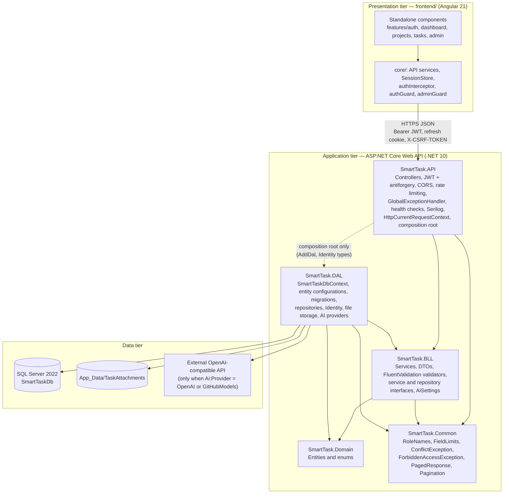
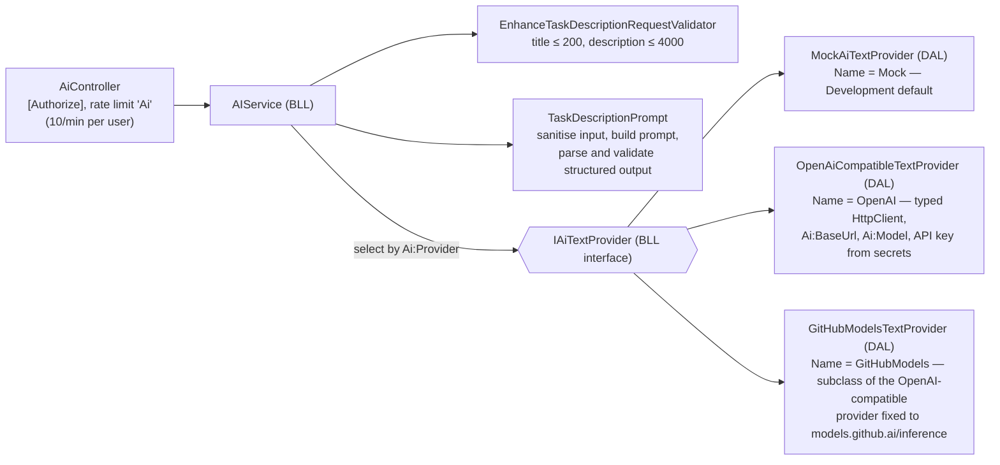

# Architecture

Smart Task Management is a three-tier application (Angular SPA, ASP.NET Core
Web API, SQL Server) whose backend is organised as an N-Layer solution
(handbook Chapter 4). Everything below reflects the code in `src/` and
`frontend/`.

## Tiers and layers



Dependency rules (handbook §4.4) are enforced by `tests/SmartTask.ArchitectureTests`:

| Test | Rule |
|---|---|
| `LayerDependencyTests` | Domain references no other SmartTask project; BLL does not reference DAL or API; repository and storage implementations live in DAL and implement BLL interfaces. |
| `ControllerBoundaryTests` | Controllers depend only on interfaces in `SmartTask.BLL.Interfaces.Services` (plus `IAntiforgery` and cookie options for `AuthController`). |
| `BusinessServiceBoundaryTests` | Every class in `SmartTask.BLL.Services.*` depends only on interfaces, and SmartTask interfaces must come from `SmartTask.BLL.Interfaces.*`. |

The DAL references the BLL so it can implement the BLL's repository and
provider interfaces (dependency inversion); the BLL never references the DAL.

## Request flow

Example: `PUT /api/v1/tasks/{taskId}/status` by a project member.

```mermaid
sequenceDiagram
    autonumber
    participant SPA as Angular (TaskService + authInterceptor)
    participant MW as API middleware pipeline
    participant C as TasksController
    participant S as TaskService (BLL)
    participant V as UpdateTaskStatusRequestValidator
    participant R as Repositories / UnitOfWork (DAL)
    participant DB as SQL Server

    SPA->>MW: PUT /api/v1/tasks/{id}/status<br/>Authorization: Bearer JWT
    Note over MW: Serilog request logging → exception handler →<br/>HTTPS redirection → routing → CORS →<br/>authentication (JWT + IsActive check) → rate limiter → authorization
    MW->>C: Authenticated request
    C->>S: UpdateStatusAsync(taskId, request, userId)
    S->>V: Validate (enum values, RowVersion format)
    S->>R: Load task (query filter excludes soft-deleted) and membership
    R->>DB: SELECT with SQL-side filters
    S->>S: Business rules (member/assignee/manager permissions)
    S->>R: Update task, add AuditLog (user, IP via ICurrentRequestContext), add notification
    R->>DB: UPDATE ... WHERE RowVersion = @original; INSERT AuditLogs
    alt stale RowVersion
        DB-->>R: 0 rows affected
        R-->>MW: DbUpdateConcurrencyException
        MW-->>SPA: 409 ProblemDetails
    else success
        S-->>C: TaskResponse DTO
        C-->>SPA: 200 JSON
    end
```

Error mapping is centralised in `GlobalExceptionHandler`: FluentValidation
errors → 400, `ForbiddenAccessException` → 403, `ConflictException` and
concurrency conflicts → 409, AI timeout/invalid response/unavailable →
504/502/503, anything else → 500 without internal details. Resources the
caller may not see are returned as 404 so GUID guessing does not reveal
existence.

## Authentication flow

Access tokens are short-lived JWTs (default 15 minutes, 30-second clock skew)
kept in memory by the SPA (`SessionStore`). Refresh tokens are random values
stored only as SHA-256 hashes in `RefreshTokens` and delivered in the
`smarttask.refresh` cookie (`HttpOnly`, `Secure`, `SameSite=Lax`, path
`/api/`). Because the refresh token travels in a cookie, register, login,
refresh and logout require an antiforgery token in the `X-CSRF-TOKEN` header
(antiforgery cookie `smarttask.csrf`).

```mermaid
sequenceDiagram
    autonumber
    participant SPA as Angular (AuthService / authInterceptor)
    participant API as AuthController
    participant AS as AuthService (BLL)
    participant DB as SQL Server

    SPA->>API: GET /api/v1/auth/csrf
    API-->>SPA: { requestToken } + smarttask.csrf cookie
    SPA->>API: POST /api/v1/auth/login {email, password}<br/>X-CSRF-TOKEN (rate limit 10/min/IP)
    API->>AS: LoginAsync (Identity password check, lockout, IsActive)
    AS->>DB: INSERT RefreshTokens (TokenHash = SHA-256)
    API-->>SPA: { accessToken, user, roles } + Set-Cookie smarttask.refresh

    SPA->>API: GET /api/v1/projects  Authorization: Bearer JWT
    Note over API: JwtBearer validates signature, issuer, audience, lifetime;<br/>OnTokenValidated rejects deactivated users

    API-->>SPA: 401 (access token expired)
    SPA->>API: GET /api/v1/auth/csrf, then POST /api/v1/auth/refresh<br/>(cookie + X-CSRF-TOKEN, single shared in-flight refresh)
    API->>AS: RefreshAsync(hash(cookie))
    alt valid, unexpired, not revoked
        AS->>DB: Revoke old token, set ReplacedByTokenId, insert new hash
        API-->>SPA: new accessToken + rotated cookie
        SPA->>API: Retry original request
    else revoked token that was already replaced (reuse)
        AS->>DB: Revoke all active tokens for the user
        API-->>SPA: 401 → SPA clears session, routes to /login
    end

    SPA->>API: POST /api/v1/auth/logout (cookie + X-CSRF-TOKEN)
    API->>AS: Revoke refresh token
    API-->>SPA: 204 + refresh cookie cleared
```

Authorization is two-level: global roles (`Admin`, `Project Manager`,
`Team Member`) through `[Authorize(Roles = ...)]` on admin controllers and
role checks in services, and resource-level checks in BLL services based on
`ProjectMembers.ProjectRole` (`Manager`, `Member`). Angular `authGuard` and
`adminGuard` only improve navigation; the API remains the authority.

## AI provider strategy



- All providers are registered in `SmartTask.DAL.DependencyInjection`;
  `AIService.SelectProvider` picks the one whose `Name` matches `Ai:Provider`
  (case-insensitive). An unknown name raises `AiProviderUnavailableException`
  (HTTP 503).
- `Ai:TimeoutSeconds` (default 20) is enforced with a linked cancellation
  token plus `WaitAsync`, so a provider that ignores cancellation still times
  out (HTTP 504). Invalid output fails validation in
  `TaskDescriptionPrompt.ParseOutput` (HTTP 502).
- Only the title and description are sent to the provider. The endpoint
  returns a suggestion; the Angular task form shows it for review and only
  replaces the description when the user accepts it. Task status, priority,
  assignment and permissions are never changed by the AI feature.
- Logging records provider name, failure type and duration only — never the
  prompt, user text, model output or keys.
- Prompt design, output schema and failure handling are documented in
  [`PROMPTS.md`](../PROMPTS.md).

## Cross-cutting concerns

| Concern | Implementation |
|---|---|
| Configuration and secrets | Options pattern; User Secrets in Development, environment variables in production; startup validation of database, JWT, CORS and rate-limit settings |
| Logging | Serilog console sink; request logging without bodies or query strings (`RequestLoggingConfiguration`) |
| Audit | `AuditLogs` via `IAuditLogRepository`; IP address from `ICurrentRequestContext` (`HttpCurrentRequestContext` in the API) or passed explicitly by `AdminUsersController` |
| Health | `GET /health` with `self` and `database` (`CanConnectAsync`) checks |
| Transport | HTTPS redirection everywhere; HSTS outside Development |
| API docs | `MapOpenApi` + Swagger UI at `/swagger` in Development; exported copy in `docs/api/openapi.json` |
