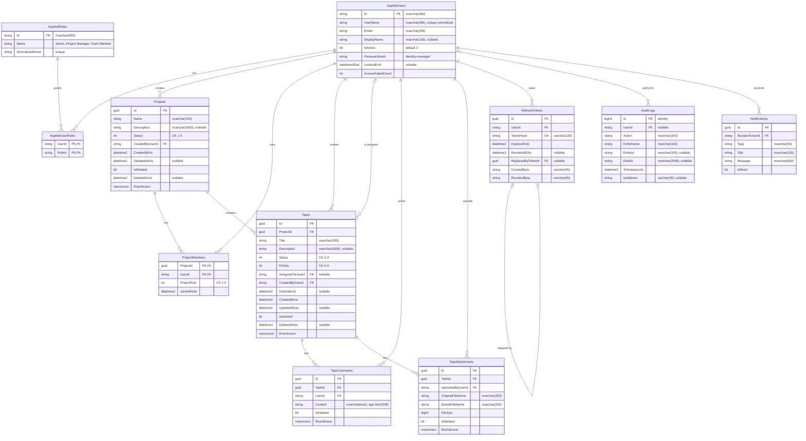

# Database

SQL Server database `SmartTaskDb` (tests use the separate `SmartTaskTestDb`).
The schema is owned by EF Core migrations in
`src/SmartTask.DAL/Persistence/Migrations`; the ERD and tables below are
derived from `SmartTaskDbContextModelSnapshot.cs` and the entity
configurations in `src/SmartTask.DAL/Persistence/Configurations`.

## Entity relationship diagram

Standard ASP.NET Identity tables that the application does not use directly
(`AspNetUserClaims`, `AspNetRoleClaims`, `AspNetUserLogins`,
`AspNetUserTokens`) exist but are omitted for readability.

## Table reference

Every foreign key uses `ON DELETE NO ACTION` (EF `DeleteBehavior.Restrict`)
except the Identity-owned tables (`AspNetUserRoles`, `AspNetUserClaims`,
`AspNetUserLogins`, `AspNetUserTokens`, `AspNetRoleClaims`), which cascade
from their user or role. Projects, tasks, comments and attachments are soft
deleted (`IsDeleted`, `DeletedAtUtc`); EF global query filters hide deleted
rows from normal queries.

### AspNetUsers (ASP.NET Identity)

| Column | Type | Null | Notes |
|---|---|---|---|
| Id | nvarchar(450) | No | PK |
| UserName / NormalizedUserName | nvarchar(256) | Yes | `UserNameIndex` unique on NormalizedUserName (filtered `IS NOT NULL`) |
| Email / NormalizedEmail | nvarchar(256) | Yes | `EmailIndex` on NormalizedEmail; uniqueness enforced by Identity (`RequireUniqueEmail`) |
| DisplayName | nvarchar(150) | Yes | Application field |
| IsActive | bit | No | Default `1`; inactive users cannot authenticate |
| PasswordHash, SecurityStamp, ConcurrencyStamp, PhoneNumber | nvarchar(max) | Yes | Identity-managed |
| EmailConfirmed, PhoneNumberConfirmed, TwoFactorEnabled, LockoutEnabled | bit | No | Identity-managed |
| LockoutEnd | datetimeoffset | Yes | Lockout (5 failures, 15 minutes) |
| AccessFailedCount | int | No | |

### AspNetRoles / AspNetUserRoles (ASP.NET Identity)

`AspNetRoles` (Id nvarchar(450) PK, Name, NormalizedName unique `RoleNameIndex`)
is seeded at startup by `IdentityRoleSeeder` with `Admin`, `Project Manager`
and `Team Member`. `AspNetUserRoles` has composite PK `(UserId, RoleId)` with
FKs to both tables.

### Projects

| Column | Type | Null | Notes |
|---|---|---|---|
| Id | uniqueidentifier | No | PK |
| Name | nvarchar(150) | No | |
| Description | nvarchar(2000) | Yes | |
| Status | int | No | `CK_Projects_Status`: `[Status] IN (1, 2, 3, 4, 5)` (Planning, Active, Completed, OnHold, Archived) |
| CreatedByUserId | nvarchar(450) | No | FK → AspNetUsers.Id |
| CreatedAtUtc | datetime2 | No | Set by `SmartTaskDbContext` on insert |
| UpdatedAtUtc | datetime2 | Yes | Set on update |
| IsDeleted | bit | No | Soft delete (CLR default `false`; no SQL default constraint) |
| DeletedAtUtc | datetime2 | Yes | |
| RowVersion | rowversion | No | Concurrency token (stale update → HTTP 409) |

Indexes: `IX_Projects_CreatedByUserId_Status`, `IX_Projects_Status_CreatedAtUtc`.

### ProjectMembers

| Column | Type | Null | Notes |
|---|---|---|---|
| ProjectId | uniqueidentifier | No | PK part 1, FK → Projects.Id |
| UserId | nvarchar(450) | No | PK part 2, FK → AspNetUsers.Id |
| ProjectRole | int | No | `CK_ProjectMembers_ProjectRole`: `[ProjectRole] IN (1, 2)` (Manager, Member) |
| JoinedAtUtc | datetime2 | No | |

Keys and indexes: composite PK `(ProjectId, UserId)` prevents duplicate
membership; `IX_ProjectMembers_UserId_ProjectId` supports "my projects".

### Tasks

| Column | Type | Null | Notes |
|---|---|---|---|
| Id | uniqueidentifier | No | PK |
| ProjectId | uniqueidentifier | No | FK → Projects.Id |
| Title | nvarchar(200) | No | |
| Description | nvarchar(4000) | Yes | |
| Status | int | No | `CK_Tasks_Status`: `[Status] IN (1, 2, 3, 4)` (ToDo, InProgress, Completed, Cancelled) |
| Priority | int | No | `CK_Tasks_Priority`: `[Priority] IN (1, 2, 3, 4)` (Low, Medium, High, Critical) |
| AssignedToUserId | nvarchar(450) | Yes | FK → AspNetUsers.Id; assignee must be a project member (enforced in `TaskService`) |
| CreatedByUserId | nvarchar(450) | No | FK → AspNetUsers.Id |
| DueDateUtc | datetime2 | Yes | |
| CreatedAtUtc / UpdatedAtUtc | datetime2 | No / Yes | |
| IsDeleted / DeletedAtUtc | bit / datetime2 | No / Yes | Soft delete |
| RowVersion | rowversion | No | Concurrency token |

Indexes: `IX_Tasks_ProjectId_Status`, `IX_Tasks_ProjectId_Priority`,
`IX_Tasks_AssignedToUserId_Status`, `IX_Tasks_DueDateUtc`,
`IX_Tasks_CreatedByUserId`.

### RefreshTokens

| Column | Type | Null | Notes |
|---|---|---|---|
| Id | uniqueidentifier | No | PK |
| UserId | nvarchar(450) | No | FK → AspNetUsers.Id |
| TokenHash | varchar(128) | No | SHA-256 hash of the token; unique `IX_RefreshTokens_TokenHash` |
| ExpiresAtUtc | datetime2 | No | |
| CreatedAtUtc / UpdatedAtUtc | datetime2 | No / Yes | |
| RevokedAtUtc | datetime2 | Yes | |
| ReplacedByTokenId | uniqueidentifier | Yes | Self-FK → RefreshTokens.Id (no cascade) |
| CreatedByIp / RevokedByIp | varchar(45) | Yes | |

Indexes: unique `TokenHash`, `(UserId, ExpiresAtUtc)`, `ExpiresAtUtc`,
`ReplacedByTokenId`.

### AuditLogs

| Column | Type | Null | Notes |
|---|---|---|---|
| Id | bigint identity(1,1) | No | PK |
| UserId | nvarchar(450) | Yes | FK → AspNetUsers.Id (no cascade, so history is preserved) |
| Action | nvarchar(100) | No | e.g. `ProjectCreated`, `TaskStatusChanged`, `UserRoleChanged` |
| EntityName | nvarchar(100) | No | `Project`, `Task` or `User` |
| EntityId | nvarchar(100) | Yes | |
| Details | nvarchar(2000) | Yes | JSON with non-sensitive change details |
| TimestampUtc | datetime2 | No | |
| IpAddress | varchar(45) | Yes | Request source IP (from `ICurrentRequestContext`, or passed by the admin controller) |

Indexes: `IX_AuditLogs_UserId_TimestampUtc`, `IX_AuditLogs_EntityName_EntityId`
(task activity timeline).

### Supporting tables (beyond the handbook's core schema)

| Table | Key columns and constraints | Indexes |
|---|---|---|
| TaskComments | Id PK; TaskId FK → Tasks; UserId FK → AspNetUsers; Content nvarchar(max) (validated to 5000 chars); soft delete; RowVersion | `(TaskId, CreatedAtUtc)`, `(UserId, CreatedAtUtc)` |
| TaskAttachments | Id PK; TaskId FK → Tasks; UploadedByUserId FK → AspNetUsers; OriginalFileName/StoredFileName nvarchar(255); StoragePath nvarchar(500); ContentType nvarchar(150); FileSize bigint; soft delete; RowVersion | `(TaskId, CreatedAtUtc)`, `(UploadedByUserId, CreatedAtUtc)` |
| Notifications | Id PK; RecipientUserId FK → AspNetUsers; Type nvarchar(50); Title nvarchar(150); Message nvarchar(500); RelatedEntityId/RelatedEntityType; IsRead; ReadAtUtc | `(RecipientUserId, CreatedAtUtc)`, `(RecipientUserId, IsRead, CreatedAtUtc)` |

### Migration history

| Migration | Purpose |
|---|---|
| `20261113023149_InitialCreate` | Identity, Projects, ProjectMembers, Tasks, RefreshTokens, AuditLogs |
| `20261113025149_FixColumnLengths` | AspNetUsers.DisplayName length |
| `20261114142951_AddTaskComments` | TaskComments |
| `20261114151250_AddTaskAttachments` | TaskAttachments |
| `20261115042626_AddNotifications` | Notifications |
| `20261116011519_AlignProjectMembershipSchema` | Projects.OwnerId renamed to CreatedByUserId; ProjectMembers composite key, role column and check |
| `20261116040857_AddUserAccountIsActive` | AspNetUsers.IsActive |
| `20261116073215_AlignRefreshTokenSchema` | TokenHash/IP column types, ReplacedByTokenId self-reference |
| `20261117070151_RemoveLegacyProjectMemberId` | Drop legacy surrogate key |
| `20261117093527_DropLegacyProjectMemberAuditColumns` | Drop legacy ProjectMembers columns |
| `20261117102239_AlignTaskConstraintsAndIndexes` | Task status/priority checks, description 4000, indexes |
| `20261117110250_AlignAuditLogSchema` | AuditLogs rebuilt with bigint identity key, EntityName, TimestampUtc, Details 2000, IpAddress varchar(45); existing rows copied |

### SQL script

[`SmartTaskDb.sql`](SmartTaskDb.sql) is an idempotent T-SQL script generated
from all of the migrations above. Each migration is guarded by an
`__EFMigrationsHistory` check, so it can be run against an empty database or
one that is partially migrated (for example in SQL Server Management Studio,
Azure Data Studio or `sqlcmd -i docs/database/SmartTaskDb.sql`). Create the
`SmartTaskDb` database first, then run the script inside it.

Regenerate it after adding a migration (with
`SMARTTASK_DESIGN_TIME_CONNECTION_STRING` set as in the
[EF Core migrations](#ef-core-migrations) section):

    dotnet ef migrations script --idempotent --project src/SmartTask.DAL --startup-project src/SmartTask.API -o docs/database/SmartTaskDb.sql

## Development database

Local development uses SQL Server 2022 defined in
`docker/docker-compose.yml` as the `sqlserver` service:

- Image: `mcr.microsoft.com/mssql/server:2022-latest` (`linux/amd64`)
- Container: `azuresqledge`
- Host: `localhost`
- Port: 1433
- SQL login: `sa`
- Data volume: `smarttask-sqldata` (mounted at `/var/opt/mssql`)

The volume has a fixed name, so data survives `docker compose down` and
container re-creation. Only `docker compose down -v` or
`docker volume rm smarttask-sqldata` deletes it.

## Local environment file

Create the Docker environment file and set a strong SA password:

    cp docker/.env.example docker/.env

Set `MSSQL_SA_PASSWORD` in `docker/.env`. If you reuse an existing
`smarttask-sqldata` volume, use the password already configured for that
database. Never commit `docker/.env` or share its contents.

ASP.NET Core does not load this Docker environment file. The application's
connection string is configured separately through ASP.NET Core
configuration and User Secrets.

## Start, check and stop

From the repository root:

    docker compose --env-file docker/.env -f docker/docker-compose.yml up -d
    docker compose --env-file docker/.env -f docker/docker-compose.yml ps
    docker compose --env-file docker/.env -f docker/docker-compose.yml down

Wait until the `sqlserver` service reports `healthy`. The health check runs
`SELECT 1` through `/opt/mssql-tools18/bin/sqlcmd -C`.

If an `azuresqledge` container already exists from a manual `docker run`,
Compose cannot create a container with the same name. Either keep using the
existing container, or remove only the container with
`docker rm -f azuresqledge` and run `up -d` again; the
`smarttask-sqldata` volume and its data are kept.

## API connection string and JWT secrets

The Docker `.env` file above is not an ASP.NET Core configuration source.
Configure API settings separately with .NET User Secrets for local
development.

The API project has a `UserSecretsId`. From the repository root, use:

    dotnet user-secrets set "ConnectionStrings:DefaultConnection" "Server=localhost,1433;Database=SmartTaskDb;User Id=sa;Password=<password>;TrustServerCertificate=True" --project src/SmartTask.API/SmartTask.API.csproj
    dotnet user-secrets set "Jwt:Issuer" "<local JWT issuer>" --project src/SmartTask.API/SmartTask.API.csproj
    dotnet user-secrets set "Jwt:Audience" "<local JWT audience>" --project src/SmartTask.API/SmartTask.API.csproj
    dotnet user-secrets set "Jwt:SigningKey" "<cryptographically random key of at least 32 UTF-8 bytes>" --project src/SmartTask.API/SmartTask.API.csproj

Replace placeholders locally; never commit actual values or paste them into
shared logs. Shell history may retain literal command-line arguments.

For production, configure these environment variables using the hosting
platform's protected configuration or secret manager:

- `ConnectionStrings__DefaultConnection`
- `Jwt__Issuer`
- `Jwt__Audience`
- `Jwt__SigningKey`

Do not put production values in `appsettings.json`, `.env.example`, or source
control. The API validates required database and JWT settings during startup.

## EF Core migrations

Migrations live in `src/SmartTask.DAL/Persistence/Migrations`. Design-time
commands use `SmartTaskDbContextFactory`, which reads the connection string
from the `SMARTTASK_DESIGN_TIME_CONNECTION_STRING` environment variable:

    export SMARTTASK_DESIGN_TIME_CONNECTION_STRING="Server=localhost,1433;Database=SmartTaskDb;User Id=sa;Password=<password>;TrustServerCertificate=True"

List migrations:

    dotnet ef migrations list --project src/SmartTask.DAL --startup-project src/SmartTask.API

Apply existing migrations when intentionally updating the configured database:

    dotnet ef database update --project src/SmartTask.DAL --startup-project src/SmartTask.API

Unset the variable afterwards. Do not create migrations merely to test
database connectivity, and review production migration scripts before
deployment.

## Integration tests

SQL Server integration tests are skipped unless
`SMARTTASK_TEST_CONNECTION_STRING` is set. They require a separate database
named `SmartTaskTestDb` and assert that name before running:

    export SMARTTASK_TEST_CONNECTION_STRING="Server=localhost,1433;Database=SmartTaskTestDb;User Id=sa;Password=<password>;TrustServerCertificate=True"
    dotnet test tests/SmartTask.IntegrationTests

Never point integration tests at development or production data.
